<h1 align="center">DataArena</h1>

<p align="center">
  <b>Локальная рабочая среда подготовки табличных данных и многокритериального выбора ML-моделей</b><br>
  открыть · понять · почистить · собрать · выгрузить · выбрать модель
</p>

<p align="center">
  
  
  
  
  
  
</p>

<p align="center">Проект FORIT TECH · версия 0.1.0 · кандидат на первый релиз</p>

---

## Содержание

1. [Назначение и область применения](#1-назначение-и-область-применения)
2. [Функциональные возможности](#2-функциональные-возможности)
3. [Интерфейс программы](#3-интерфейс-программы)
4. [Архитектура](#4-архитектура)
5. [Модель данных](#5-модель-данных)
6. [Безопасность](#6-безопасность)
7. [Используемые технологии](#7-используемые-технологии)
8. [Структура проекта](#8-структура-проекта)
9. [Установка и запуск](#9-установка-и-запуск)
10. [Проверка качества](#10-проверка-качества)
11. [Ограничения](#11-ограничения)
12. [Документация](#12-документация)

---

## 1 Назначение и область применения

Типичная задача аналитика: есть один или несколько файлов с данными. Нужно понять,
что внутри, проверить качество, исправить проблемы, объединить источники, собрать
итоговый датасет, сохранить его в нужном формате — а затем, когда модели обучены,
выбрать лучшую не по одной метрике, а с учётом времени отклика и размера.

Обычно первая часть делается в ноутбуке: двадцать ячеек `pandas`, которые никто
не воспроизведёт через месяц. DataArena делает ту же работу в инструменте, где каждое
действие остаётся **шагом**: его видно, его можно отменить, сохранить и повторить,
а исходный файл не меняется никогда.

**DataArena отвечает за слой данных и выбор модели.** Модели обучает
[ModelArena](https://github.com/forit-tech/ModelArena) — отдельный сервис; связь с ним
идёт через замороженный контракт Dataset Package v1. DataArena полностью работает без
ModelArena.

Программа локальная и однопользовательская: сервер слушает только `127.0.0.1`,
данные не покидают компьютер.

## 2 Функциональные возможности

<p align="center"><b>Таблица 1 — Разделы программы</b></p>

| Раздел | Назначение | Состояние |
|---|---|---|
| **Файлы** | несколько датасетов разных форматов в одном рабочем пространстве, нормализация в рабочий Parquet | работает |
| **Данные** | таблица до миллиона строк: страницы, сортировка, поиск, показатели колонки с распределением | работает |
| **SQL-запрос** | панель под таблицей: запросы к нескольким датасетам, история, сохранённые запросы, отмена | работает, движок в отдельном процессе |
| **Конвейер** | 16 операций очистки, отмена и повтор, предпросмотр последствий, выгрузка и пакет | работает |
| **Качество** | диагностика результата шагов, у каждой находки — конкретные строки и вариант исправления | работает |
| **Сборка** | соединение датасетов: анализ ключей, прогноз числа строк до выполнения, автоподбор | работает |
| **Происхождение** | откуда взялся датасет, кто родители соединения, что стало с каждой колонкой | работает |
| **Выбор модели** | Decision Lab: TOPSIS, ограничения и фронт Парето, фиксированные шкалы, устойчивость, отчёт | работает, [исследование](docs/research/) |
| **Рецепты** | отдельный раздел для рецептов | не сделан; рецепт хранится внутри `.dapkg` |

**Форматы чтения и записи:** CSV, TSV, Parquet, JSON, JSONL/NDJSON, XLSX, Feather, Arrow IPC.

**Операции конвейера:** удалить, переименовать, переставить и скопировать колонки; сменить
тип; оставить или удалить строки по условию; сортировка; замена значений; заполнение
пропусков; приведение пометок вида «н/д» к пропускам; удаление дубликатов; удаление краевых
пробелов; приведение регистра; разбор чисел и дат.

**Decision Lab** сравнивает модели в четырёх режимах:

| Режим | Метод |
|---|---|
| A | победитель по одной основной метрике — то, что обычно делают на практике |
| B | классический TOPSIS (Hwang, Yoon, 1981) |
| C | жёсткие ограничения → фронт Парето → TOPSIS; устойчив к добавлению доминируемых моделей |
| D | полезности на шкалах, заданных до сравнения → TOPSIS с фиксированным идеалом; место модели не зависит от состава набора |

К рекомендации прилагаются интервалы устойчивости к весам, доля сценариев Монте-Карло,
в которых модель побеждает, учёт шума измерений и отчёт в JSON, CSV и Markdown.

**ИИ-советник (необязательный).** Если на компьютере запущена локальная модель (Ollama
или OpenAI-совместимый сервер), разделы «Качество» и «Сборка» могут объяснить находку
словами и выбрать один из уже проверенных вариантов исправления. Числа считает DataArena,
модель ничего не выполняет; без модели всё работает.

## 3 Интерфейс программы

Снимки сделаны скриптом [`scripts/capture_docs.py`](scripts/capture_docs.py) в запущенном
приложении (Chrome, 1560 × 1000): данные загружаются через API, Decision Lab работает
на реальных измерениях моделей scikit-learn на датасете breast_cancer. Ничего не дорисовано.

### 3.1 Файлы

<p align="center">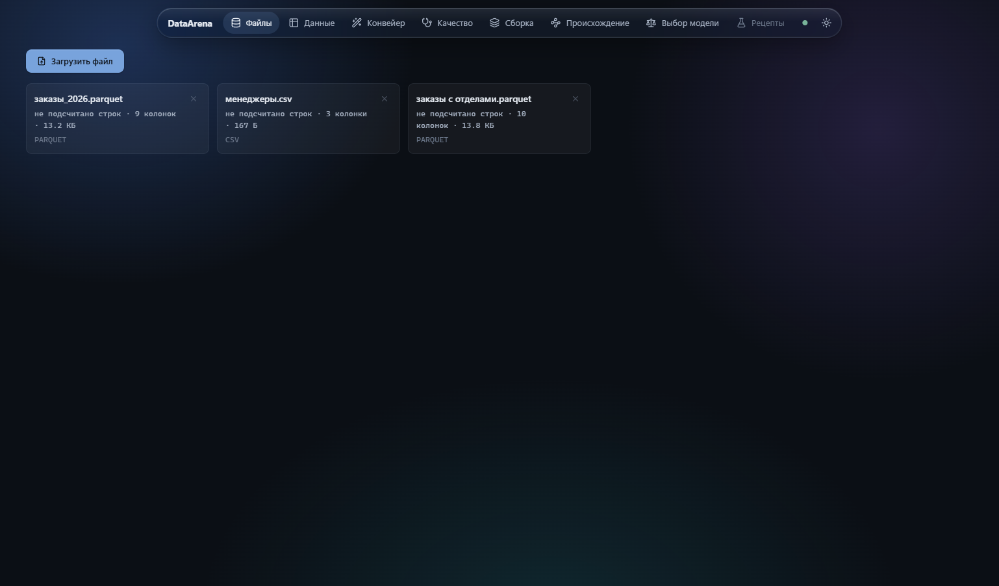</p>
<p align="center"><i>Рисунок 1 — Раздел «Файлы»: два загруженных источника и датасет, собранный из них</i></p>

### 3.2 Данные и SQL-запрос

<p align="center">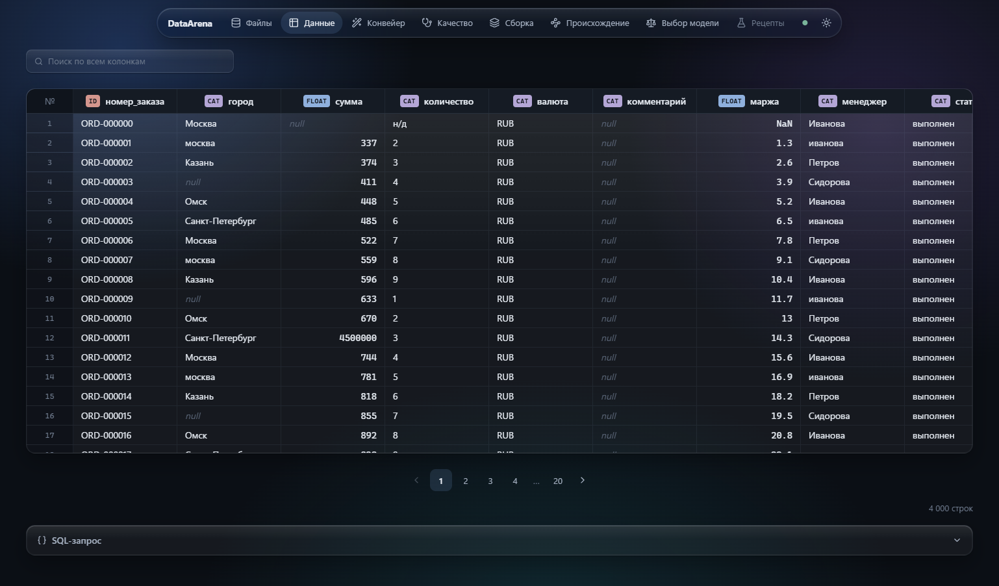</p>
<p align="center"><i>Рисунок 2 — Раздел «Данные»: типы колонок, пропуски (<code>null</code>), значения <code>NaN</code>, нумерованные страницы</i></p>

<p align="center">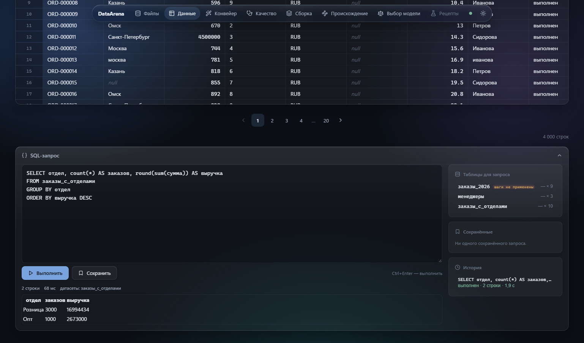</p>
<p align="center"><i>Рисунок 3 — Панель «SQL-запрос»: запрос к собранному датасету, результат, список таблиц и история</i></p>

### 3.3 Конвейер

<p align="center">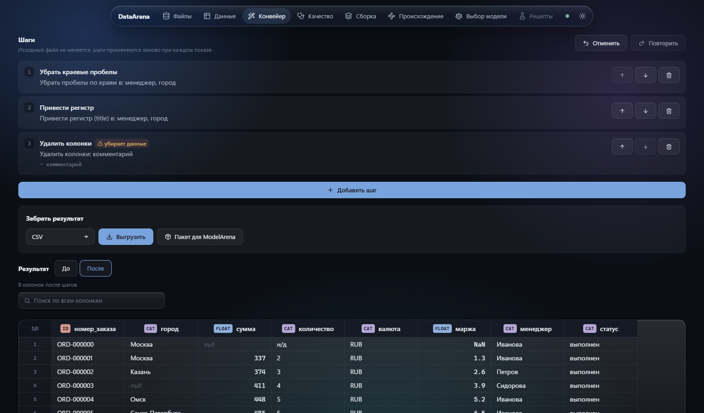</p>
<p align="center"><i>Рисунок 4 — Раздел «Конвейер»: три шага очистки; разрушающий шаг помечен «убирает данные»</i></p>

### 3.4 Качество

<p align="center">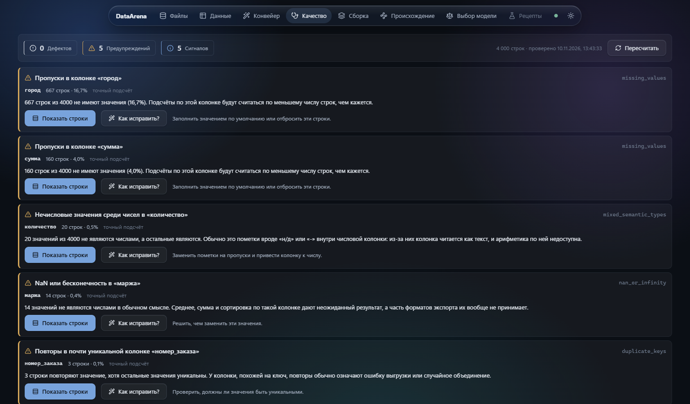</p>
<p align="center"><i>Рисунок 5 — Раздел «Качество»: находки по результату шагов, переход к строкам и вариант исправления</i></p>

### 3.5 Сборка

<p align="center">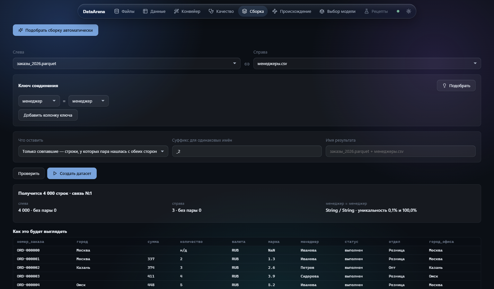</p>
<p align="center"><i>Рисунок 6 — Раздел «Сборка»: ключ «менеджер = менеджер», прогноз 4 000 строк и связи N:1 до выполнения</i></p>

### 3.6 Происхождение

<p align="center">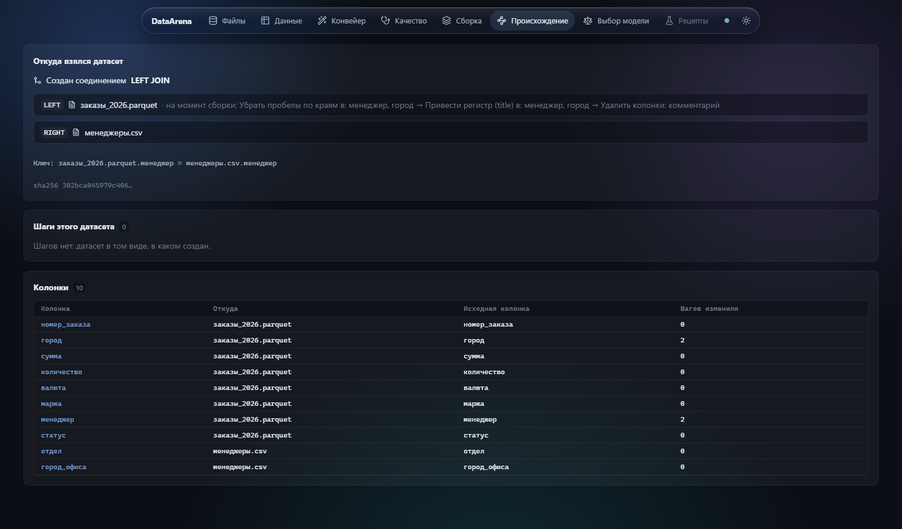</p>
<p align="center"><i>Рисунок 7 — Раздел «Происхождение»: родители соединения, шаги левого родителя на момент сборки, источник каждой колонки</i></p>

### 3.7 Выбор модели (Decision Lab)

<p align="center">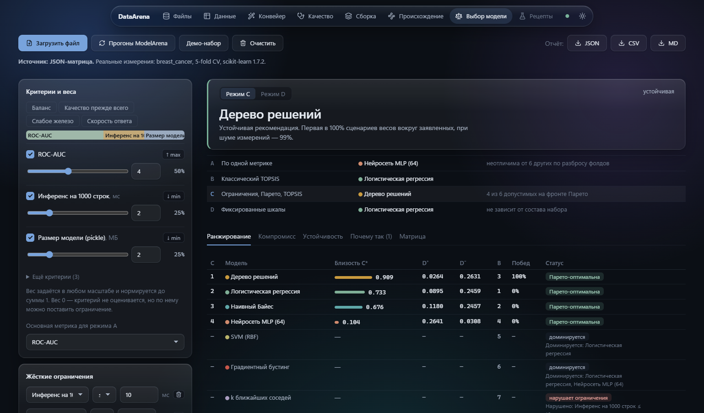</p>
<p align="center"><i>Рисунок 8 — Режим C: ограничения «инференс ≤ 10 мс» и «размер ≤ 1 МБ», рекомендация и сравнение режимов A–D</i></p>

<p align="center">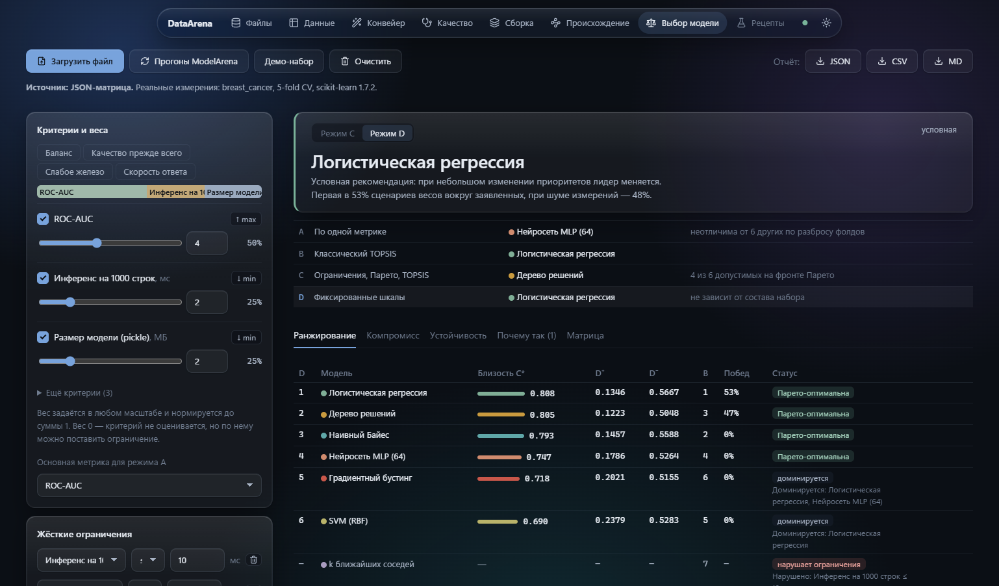</p>
<p align="center"><i>Рисунок 9 — Режим D (фиксированные шкалы): при тех же весах рекомендация меняется</i></p>

<p align="center">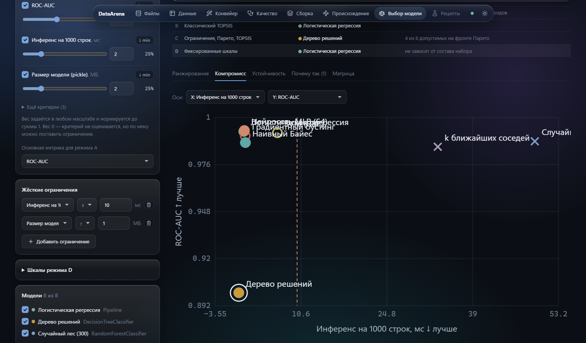</p>
<p align="center"><i>Рисунок 10 — Вкладка «Компромисс»: график «качество — время инференса»</i></p>

<p align="center">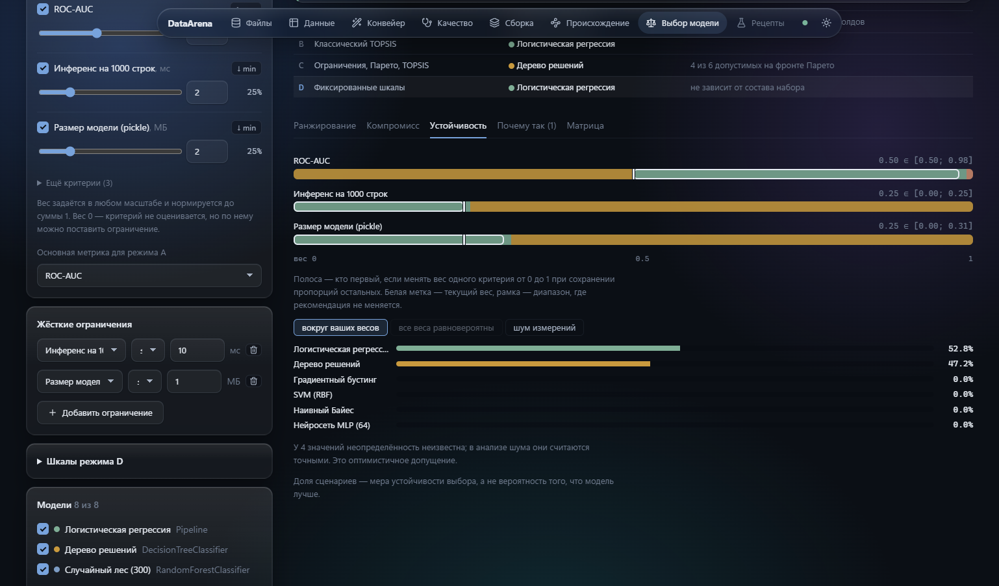</p>
<p align="center"><i>Рисунок 11 — Вкладка «Устойчивость»: интервалы весов и доли сценариев</i></p>

<p align="center">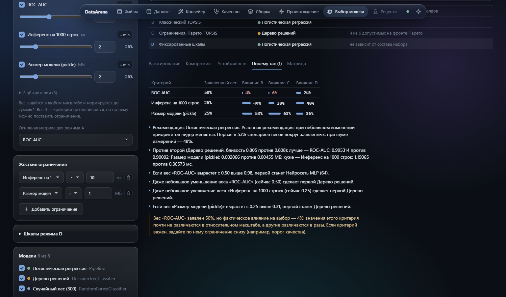</p>
<p align="center"><i>Рисунок 12 — Вкладка «Почему так»: заявленный вес и фактическое влияние критериев</i></p>

<p align="center">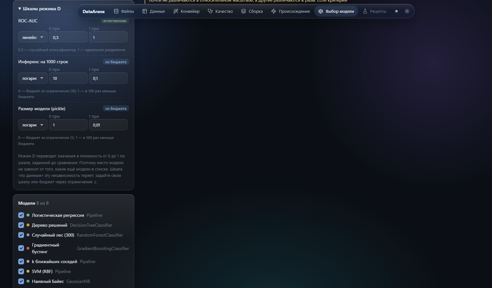</p>
<p align="center"><i>Рисунок 13 — Шкалы режима D с указанием источника</i></p>

### 3.8 Светлая тема

<p align="center">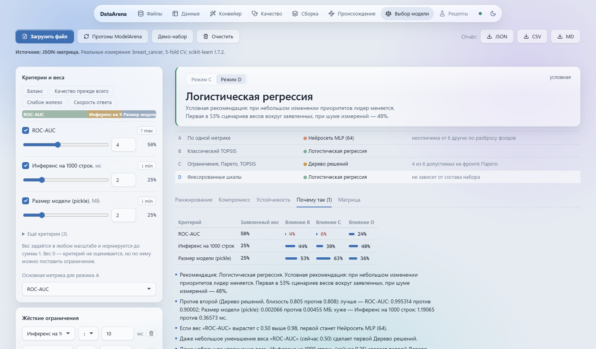</p>
<p align="center"><i>Рисунок 14 — Светлая тема, раздел «Выбор модели»; тема переключается кнопкой в навигации</i></p>

<p align="center">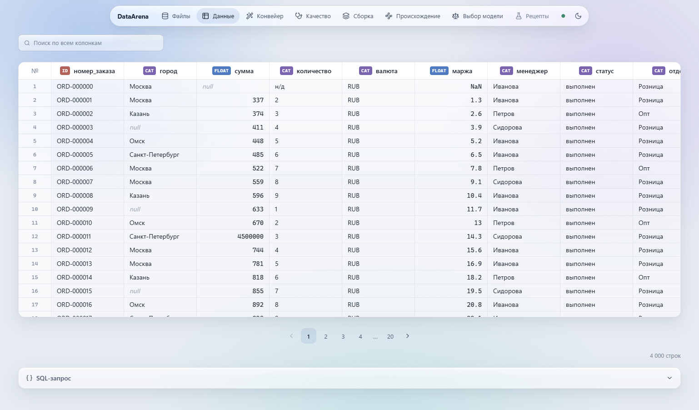</p>
<p align="center"><i>Рисунок 15 — Светлая тема, раздел «Данные»</i></p>

## 4 Архитектура

Клиент-серверное приложение, оба процесса работают на одном компьютере.

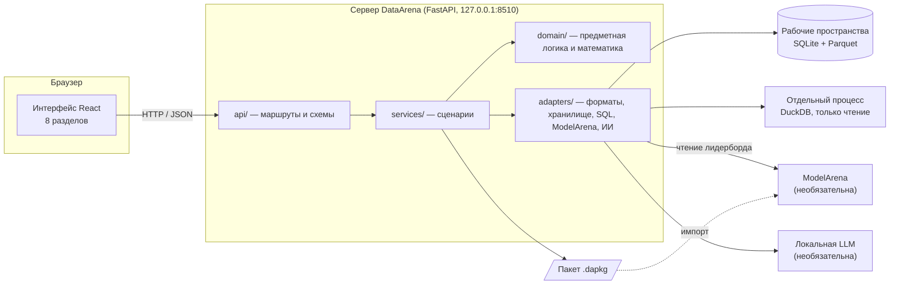

<p align="center"><i>Рисунок 16 — Общая схема программы</i></p>

Сервер разделён на слои, направление зависимостей `api → services → domain`,
`services → adapters`. Правило проверяется [тестом на граф импортов](tests/unit/test_import_graph.py),
а не договорённостью: слой `domain` не знает про HTTP, файлы и SQL-движок, поэтому
математика Decision Lab тестируется без запуска сервера.

<p align="center"><b>Таблица 2 — Слои сервера</b></p>

| Слой | Каталог | Ответственность |
|---|---|---|
| HTTP | `backend/api` | маршруты, проверка входа (Pydantic), единый формат ошибок |
| Сценарии | `backend/services` | загрузка, просмотр, SQL, конвейер, диагностика, соединения, выгрузка, пакет, происхождение, Decision Lab, ИИ-советник |
| Предметная область | `backend/domain` | модели датасета, шаги конвейера, правила диагностики, анализ соединений, эффекты на колонки, TOPSIS, Парето, шкалы, устойчивость |
| Адаптеры | `backend/adapters` | реестр форматов, хранилище (SQLite), DuckDB в отдельном процессе, отпечаток пакета, клиенты ModelArena и LLM |
| Ядро | `backend/core` | настройки из окружения, иерархия ошибок, журнал |

Ключевые решения:

- **Рабочее пространство на сервере, а не stateless-запросы.** Файл загружается один раз
  и нормализуется в Parquet; дальше все разделы читают его лениво (`scan_parquet`),
  не перечитывая исходник при каждом запросе.
- **Конвейер — список шагов, а не изменённый файл.** Исходник неизменен, шаги применяются
  заново при каждом показе; отмена и повтор переживают перезагрузку страницы.
- **SQL — в отдельном процессе с перечнем разрешённых функций.** Падение движка не уносит
  сервер (долг [D-01](docs/ARCHITECTURAL_DEBT.md) закрыт), запрос можно отменить.
- **Происхождение выводится из эффектов шагов.** Каждая операция объявляет, что делает
  с колонками; история колонки складывается из этих объявлений.

Подробно, с диаграммами последовательностей, развёртывания и обоснованием каждого
решения, — в [пояснительной записке](docs/EXPLANATORY_NOTE.md#4-описание-архитектуры)
и [ARCHITECTURE.md](docs/ARCHITECTURE.md).

## 5 Модель данных

Состояние рабочих пространств хранится в SQLite, данные — в файлах рядом.

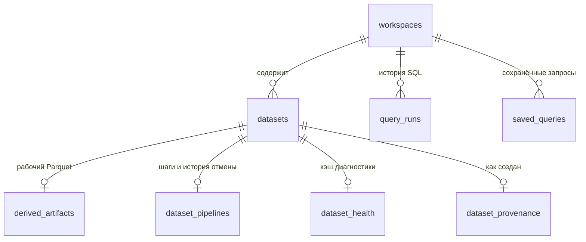

<p align="center"><i>Рисунок 17 — Таблицы хранилища рабочих пространств</i></p>

Схема создаётся в [`workspace_store.py`](backend/adapters/storage/workspace_store.py) и
версионируется таблицей `schema_version`. Обмен с ModelArena идёт через пакет `.dapkg`
(Dataset Package `dataarena.package/1`, версия 1.1.0): данные, схема, рецепт, происхождение,
логический отпечаток SHA-256. Контракт [заморожен](docs/contracts/), пакет из приложения
проходит эталонный валидатор без ошибок и предупреждений.

## 6 Безопасность

- Сервер слушает только `127.0.0.1`; CORS разрешён только адресам интерфейса.
- SQL — только чтение: перечень разрешённых функций, отдельный процесс, отмена, предел
  времени запроса (30 с по умолчанию). Попытки обхода песочницы из предшественника воспроизведены тестами
  (`tests/security/`).
- Пределы на входе: размер загрузки (512 МБ по умолчанию), глубина JSON (100 уровней),
  число шагов конвейера (200) и размер их параметров (64 КБ).
- Ошибки отдаются в едином формате `{"error": {code, message, details}}` без трассировок
  и путей файловой системы.
- ИИ-советник получает только агрегаты и примеры значений, которые пользователь и так
  видит; названия колонок передаются как данные, ответ сверяется с закрытым списком вариантов.
- Перед приёмкой каждый этап проходит враждебный разбор:
  [54 находки с воспроизведением](SECURITY_AND_ROBUSTNESS_REVIEW.md).

Аутентификации нет — это локальный однопользовательский инструмент. При выносе сервера
наружу она стала бы обязательной.

## 7 Используемые технологии

### Сервер
- Python 3.12 · FastAPI · Pydantic 2 · Uvicorn
- Polars (ленивые вычисления) · DuckDB (SQL) · PyArrow · fastexcel · XlsxWriter · NumPy
- SQLite (состояние рабочих пространств)

### Интерфейс
- React 19 · TypeScript 5.9 · Vite 7
- три зависимости: `react`, `react-dom`, `lucide-react`; UI-фреймворка нет — свой CSS
  на переменных, тёмная и светлая темы

### Проверка
- pytest · ruff · mypy · Vitest · ESLint
- мутационная проверка набора тестов, сквозные проверки на настоящем сервере

## 8 Структура проекта

```
DataArena/
├── backend/
│   ├── api/            маршруты и схемы HTTP
│   ├── services/       сценарии: импорт, конвейер, SQL, диагностика, сборка, пакет, Decision Lab
│   ├── domain/         предметная логика: dataset, pipeline, health, joins, lineage, decision
│   ├── adapters/       formats, storage, engine (DuckDB), package, modelarena, ai
│   ├── core/           настройки, ошибки, журнал
│   └── main.py         точка входа ASGI
├── frontend/src/
│   ├── app/            оболочка и навигация
│   ├── features/       workspace, dataset-table, sql, pipeline, health, builder, lineage, decision
│   ├── api/            клиент и перечень запросов
│   ├── styles/         токены и стили разделов
│   └── types/          типы ответов сервера
├── tests/              unit, integration, contract, security, performance
├── scripts/            сквозные проверки, съёмка экранов, стенд измерения моделей
├── tools/              мутационная проверка
├── docs/               пояснительная записка, описание программы, архитектура, контракты, исследование
└── examples/           примеры входных файлов
```

## 9 Установка и запуск

Нужны **Python 3.12+** и **Node.js 22+**.

### 9.1 Клонирование

```bash
git clone https://github.com/forit-tech/DataArena.git
```

```bash
cd DataArena
```

### 9.2 Установка зависимостей

```bash
python -m venv .venv
```

```bash
.venv/Scripts/pip install -e ".[dev]"
```

На Linux/macOS — `.venv/bin/pip`.

```bash
cd frontend && npm install
```

### 9.3 Запуск

Сервер:

```bash
.venv/Scripts/python -m uvicorn backend.main:app --host 127.0.0.1 --port 8510
```

Интерфейс (из каталога `frontend`):

```bash
npm run dev
```

Интерфейс — `http://127.0.0.1:5174`, документация API (OpenAPI) — `http://127.0.0.1:8510/docs`.

### 9.4 Настройки

Ни одна переменная окружения не обязательна.

<p align="center"><b>Таблица 3 — Переменные окружения</b></p>

| Переменная | По умолчанию | Назначение |
|---|---|---|
| `DATAARENA_WORKSPACE_ROOT` | `~/.dataarena/workspaces` | где хранятся рабочие пространства |
| `DATAARENA_MAX_UPLOAD_MB` | `512` | предел размера загружаемого файла |
| `DATAARENA_ALLOWED_ORIGINS` | `http://localhost:5174,http://127.0.0.1:5174` | адреса интерфейса для CORS |
| `DATAARENA_MODELARENA_URL` | не задан | адрес ModelArena для Decision Lab |
| `DATAARENA_AI_ENABLED` | `1` | включить ИИ-советник, если модель доступна |
| `DATAARENA_AI_PROVIDER` | `ollama` | `ollama` или OpenAI-совместимый сервер |
| `DATAARENA_AI_URL`, `DATAARENA_AI_MODEL` | адрес по умолчанию провайдера | где искать локальную модель и какую взять |

Пример — в [`.env.example`](.env.example).

### 9.5 Типовой сценарий

1. **Файлы** → «Загрузить файл» → CSV, XLSX, Parquet и др.
2. **Данные** — просмотреть таблицу, при необходимости выполнить SQL-запрос.
3. **Качество** — найти проблемы, перейти к строкам, применить исправление.
4. **Конвейер** — добавить шаги очистки, проверить «До / После».
5. **Сборка** — соединить с другим датасетом, проверив прогноз числа строк.
6. Выгрузить результат или собрать **пакет для ModelArena**.
7. **Выбор модели** — загрузить лидерборд или матрицу характеристик, задать веса
   и ограничения, получить рекомендацию и выгрузить отчёт.

## 10 Проверка качества

```bash
.venv/Scripts/python -m pytest
```

```bash
.venv/Scripts/ruff check backend tests
```

```bash
.venv/Scripts/python -m mypy
```

```bash
cd frontend && npm run lint && npx tsc --noEmit && npm run test && npm run build
```

Зелёные тесты сами по себе ничего не доказывают, поэтому набор проверяется мутациями:
каждая снимает одну защиту, и набор обязан покраснеть.

```bash
python tools/mutation_check.py
```

Сквозные проверки на настоящем сервере с перезапуском и сверкой отпечатков исходных
файлов до и после:

```bash
python scripts/smoke_sql.py
```

```bash
python scripts/smoke_health.py
```

Контракт Dataset Package в CI прогоняется на двух версиях Polars:

```bash
python docs/contracts/reference/run_matrix.py docs/contracts
```

<p align="center"><b>Таблица 4 — Результаты проверки на 10.11.2026</b></p>

| Проверка | Результат |
|---|---|
| Тесты сервера (pytest) | 1227 пройдено, 0 упало |
| Тесты интерфейса (Vitest) | 107 пройдено, 0 упало |
| ruff, mypy, ESLint, сборка интерфейса | без замечаний |
| Мутационная проверка | 74 мутации в наборе; в эту редакцию не перепрогонялась |

## 11 Ограничения

- **Нет аутентификации** — инструмент локальный и однопользовательский.
- **SQL и раздел «Данные» читают исходный файл, а не результат конвейера.** Остальные
  разделы — диагностика, сборка, выгрузка, пакет — работают с результатом шагов. Это
  несогласованность, а не замысел: устранить её можно только материализацией результата.
- **Около секунды на SQL-запрос** — плата за изоляцию: один запрос — один процесс.
- **Происхождение выводится из шагов, а не хранится.** Правка данных вне конвейера
  (выгрузка, ручное изменение, повторная загрузка) остаётся за его пределами; у датасетов,
  созданных до появления записей, раздел честно отвечает «неизвестно».
- **Память диагностики растёт линейно** — около 0,4 КБ на строку: четыре миллиона строк
  стоят полтора гигабайта.
- **Один процесс на одну базу.** Очередь правок конвейера держится замком процесса;
  несколько рабочих процессов uvicorn на одной базе не поддерживаются.
- **Время с часовым поясом** в CSV, TSV и XLSX выгружается в UTC; Parquet, Feather, Arrow
  и JSON сохраняют пояс.
- **Decision Lab** даёт меру компромисса и устойчивости выбора, а не статистическое
  доказательство превосходства модели; время инференса и память ModelArena не измеряет —
  их вводят из файла или меряют стендом `scripts/research/measure_models.py`.
- **Раздела «Рецепты» нет** — рецепт существует только внутри пакета `.dapkg`.

## 12 Документация

<p align="center"><b>Таблица 5 — Документы проекта</b></p>

| Документ | Содержание |
|---|---|
| [Пояснительная записка](docs/EXPLANATORY_NOTE.md) | по ГОСТ 19.404-79: постановка задачи, архитектура, алгоритмы, выбор технических средств, технико-экономические показатели |
| [Описание программы](docs/PROGRAM_DESCRIPTION.md) | по ГОСТ 19.402-78: логическая структура, вызов, входные и выходные данные, HTTP API |
| [ARCHITECTURE.md](docs/ARCHITECTURE.md) | архитектурные решения и обоснование каждой зависимости |
| [ARCHITECTURAL_DEBT.md](docs/ARCHITECTURAL_DEBT.md) | архитектурный долг и его закрытие |
| [docs/contracts/](docs/contracts/) | Dataset Package v1: спецификация, JSON Schema, эталонные реализации |
| [docs/research/](docs/research/) | математическая модель и эксперименты Decision Lab |
| [SECURITY_AND_ROBUSTNESS_REVIEW.md](SECURITY_AND_ROBUSTNESS_REVIEW.md) | враждебные разборы этапов |
| [AUDIT.md](AUDIT.md) | аудит предшественника — AutoDataAnalysis |
| [IMPLEMENTATION_PLAN.md](docs/IMPLEMENTATION_PLAN.md), [MIGRATION_MAP.md](docs/MIGRATION_MAP.md), [RISKS.md](docs/RISKS.md), [TEST_SUITE_AUDIT.md](docs/TEST_SUITE_AUDIT.md) | план этапов, карта переноса, риски, аудит набора тестов |

---

**Происхождение проекта.** DataArena выросла из
[AutoDataAnalysis](https://github.com/forit-tech/AutoDataAnalysis), который совмещал слой
данных и ML. Аудит показал, что слой данных переиспользуем примерно на 60 %, но его основание —
stateless-сервер, заново загружающий файл при каждой операции, — блокирует большинство
требований. Поэтому проект разделён на два сервиса, а не переписан на месте
([AUDIT.md](AUDIT.md), находка A-1).

**Лицензия** будет определена до первого публичного релиза.
