# DataArena. Пояснительная записка

**Документ составлен по структуре ГОСТ 19.404-79 «ЕСПД. Пояснительная записка.
Требования к содержанию и оформлению».** Разделы 2–6 вместе составляют раздел
«Технические характеристики» стандарта; архитектура программы описана в разделе 4.
Оформление печатной версии (поля, нумерация листов, лист утверждения
по ГОСТ 19.104-78 и ГОСТ 19.106-78) выполняется при переносе в текстовый редактор.

| Реквизит | Значение |
|---|---|
| Наименование программы | DataArena — локальная рабочая среда подготовки табличных данных и многокритериального выбора моделей машинного обучения |
| Версия | 0.1.0 (кандидат на первый релиз) |
| Разработчик | проект FORIT TECH |
| Связанная программа | ModelArena, репозиторий `forit-tech/ModelArena` |
| Сопутствующие документы | [Описание программы](PROGRAM_DESCRIPTION.md) (ГОСТ 19.402-78), [README](../README.md) |
| Дата редакции | 10.11.2026 |

## Аннотация

В пояснительной записке обоснованы назначение программы DataArena, постановка задачи,
выбранные алгоритмы и архитектура, организация входных и выходных данных, выбор
технических средств и ожидаемые технико-экономические показатели. Программа загружает
табличные данные разных форматов в рабочее пространство, позволяет исследовать и очищать
их воспроизводимыми шагами, собирать датасет из нескольких источников, выгружать его
и передавать в сервис обучения моделей ModelArena через пакет Dataset Package v1,
а также выбирать модель по нескольким противоречивым критериям методами
многокритериального принятия решений.

## Содержание

- [Введение](#введение)
- [1 Назначение и область применения](#1-назначение-и-область-применения)
- [2 Постановка задачи](#2-постановка-задачи)
- [3 Описание алгоритмов](#3-описание-алгоритмов)
- [4 Описание архитектуры](#4-описание-архитектуры)
- [5 Организация входных и выходных данных](#5-организация-входных-и-выходных-данных)
- [6 Выбор технических средств](#6-выбор-технических-средств)
- [7 Ожидаемые технико-экономические показатели](#7-ожидаемые-технико-экономические-показатели)
- [8 Источники, использованные при разработке](#8-источники-использованные-при-разработке)
- [Приложение А. Экранные формы](#приложение-а-экранные-формы)

---

## Введение

**Наименование программы** — DataArena.

**Краткая характеристика области применения.** Подготовка табличных данных к анализу
и машинному обучению: проверка качества, очистка, объединение источников, выгрузка;
выбор обученной модели с учётом качества, времени отклика и размера.

**Основания для разработки.** Программа разработана как преемник инструмента
AutoDataAnalysis. Аудит предшественника ([AUDIT.md](../AUDIT.md)) показал, что его слой
данных переиспользуем примерно на 60 %, однако архитектурное основание — сервер без
состояния, заново загружающий файл при каждой операции, — блокирует работу с большими
таблицами, воспроизводимость и отмену действий (находка A-1). Решено разделить продукт
на два сервиса: DataArena (данные и выбор модели) и ModelArena (обучение). Этапы работ
и критерии их готовности зафиксированы в [IMPLEMENTATION_PLAN.md](IMPLEMENTATION_PLAN.md),
карта переноса кода — в [MIGRATION_MAP.md](MIGRATION_MAP.md).

---

## 1 Назначение и область применения

### 1.1 Функциональное назначение

Программа предназначена для:

- загрузки нескольких табличных файлов разных форматов в одно рабочее пространство;
- просмотра таблиц объёмом до миллиона строк и выполнения SQL-запросов только на чтение;
- автоматической диагностики качества данных с переходом к конкретным строкам;
- очистки и преобразования данных последовательностью отменяемых шагов, не изменяющих
  исходный файл;
- соединения датасетов с предварительным анализом ключей и прогнозом числа строк;
- отслеживания происхождения датасета и каждой его колонки;
- выгрузки результата в восемь форматов и сборки пакета для ModelArena;
- многокритериального выбора ML-модели с анализом устойчивости рекомендации.

### 1.2 Эксплуатационное назначение

Программа рассчитана на аналитиков данных, инженеров машинного обучения, студентов
и исследователей, работающих на собственном компьютере. Она локальная
и однопользовательская: сервер принимает соединения только с `127.0.0.1`, данные
не передаются за пределы компьютера. Программа не обучает модели — это задача ModelArena.

### 1.3 Область применения

Подготовка учебных и производственных датасетов, разведочный анализ, воспроизводимая
очистка данных перед обучением, выбор модели для развёртывания на оборудовании
с ограничениями по времени отклика и памяти, научные эксперименты по методам
многокритериального выбора ([docs/research/](research/)).

---

## 2 Постановка задачи

### 2.1 Исходная проблема

Подготовка данных обычно выполняется в интерактивном блокноте последовательностью ячеек
`pandas`. Такой способ имеет четыре недостатка:

1. **Невоспроизводимость.** Порядок выполнения ячеек не фиксируется, результат зависит
   от состояния интерпретатора.
2. **Изменение исходника.** Промежуточные результаты перезаписывают данные, и вернуться
   к исходному состоянию нельзя.
3. **Скрытые последствия.** Соединение таблиц по неуникальному ключу молча умножает строки;
   смена типа молча превращает значения в пропуски.
4. **Выбор модели по одной метрике.** Модель с наибольшей точностью может не уложиться
   в ограничения по времени отклика или памяти, а разница в метрике — оказаться в пределах
   разброса между фолдами.

### 2.2 Требования к программе

<b>Таблица 1 — Требования и способ их выполнения</b>

| № | Требование | Способ выполнения |
|---|---|---|
| Т1 | Таблица до 1 000 000 строк открывается без загрузки целиком в память браузера | постраничное чтение с сервера, ленивое сканирование Parquet |
| Т2 | Исходный файл никогда не изменяется | конвейер хранится как список шагов и применяется при каждом показе |
| Т3 | Любое действие отменяемо, в том числе после перезагрузки страницы | история отмены хранится на сервере вместе с шагами |
| Т4 | Разрушающее действие показывает последствия до применения | расчёт числа удаляемых строк и теряемых значений (`/pipeline/impact`) |
| Т5 | Соединение показывает прогноз размера до выполнения | анализ уникальности и пересечения ключей, вывод кардинальности |
| Т6 | Ошибка SQL-движка не нарушает работу сервера | выполнение запроса в отдельном процессе |
| Т7 | Пользовательский SQL не читает и не пишет файлы вне рабочего пространства | только чтение, перечень разрешённых функций |
| Т8 | Передача в ModelArena по формальному контракту | Dataset Package v1 с JSON Schema и логическим отпечатком |
| Т9 | Выбор модели учитывает несколько критериев, ограничения и неопределённость измерений | Decision Lab: TOPSIS, Парето, фиксированные шкалы, Монте-Карло |
| Т10 | Повторный расчёт даёт тот же результат | фиксированный `seed`, SHA-256 входа в отчёте |
| Т11 | Программа работает без ModelArena и без языковой модели | обе связи необязательны и проверяются тестами при недоступном сервисе |

### 2.3 Границы задачи

В задачу не входят: обучение и оценка моделей (ModelArena), многопользовательская
работа и аутентификация, хранение данных в удалённых СУБД, отдельный раздел работы
с рецептами (рецепт хранится в пакете `.dapkg`).

---

## 3 Описание алгоритмов

### 3.1 Импорт и нормализация файла

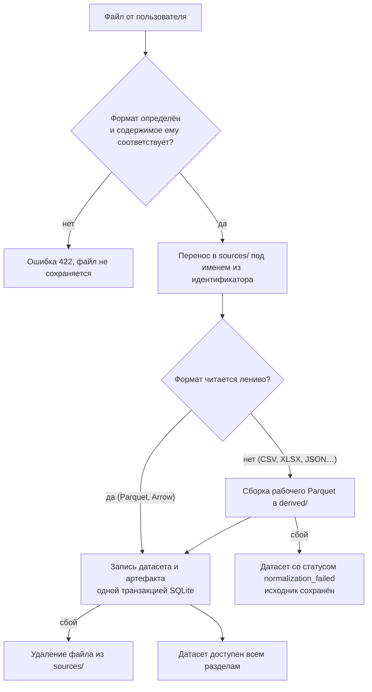

<i>Рисунок 1 — Алгоритм импорта файла</i>

Порядок шагов выбран так, чтобы неудача на любом шаге оставляла систему в понятном
состоянии: сбой конвертации не теряет загруженный файл, сбой записи не оставляет
осиротевших файлов. Повторная загрузка того же содержимого возвращает тот же датасет
(адресация по содержимому); результат соединения, напротив, всегда новый датасет.

### 3.2 Конвейер преобразований

Конвейер — упорядоченный список шагов `(step_id, kind, params)` из закрытого перечня
шестнадцати операций. При каждом показе шаги заново применяются к ленивому плану Polars
поверх рабочего Parquet:

$$D_n = f_n(\dots f_2(f_1(D_0))\dots),$$

где $D_0$ — неизменный исходник, $f_i$ — операция шага $i$. Каждая операция объявляет
**эффект на колонки** (изменяет, переименовывает, создаёт, удаляет колонку или меняет
только строки); из этих объявлений выводятся состав колонок после шага и происхождение
каждой колонки (раздел 3.5). Сохранение списка шагов помещает предыдущее состояние
в историю отмены. Пределы: не более 200 шагов и 64 КБ параметров на шаг.

Для разрушающих шагов (удаление строк и колонок, смена типа, разбор чисел и дат)
до применения рассчитываются: число строк до и после, число удаляемых строк и число
значений, которые станут пропусками.

### 3.3 Диагностика качества

Диагностика выполняется по **результату конвейера**, а не по исходнику. Проверки
разделены по уровням: дефект, предупреждение, сигнал.

<b>Таблица 2 — Проверки качества</b>

| Проверка | Что обнаруживает |
|---|---|
| `all_null_column`, `constant_column`, `near_constant_column` | пустые, постоянные и почти постоянные колонки |
| `missing_values`, `empty_string_vs_null` | пропуски; пустые строки, смешанные с пропусками |
| `duplicate_rows`, `duplicate_keys` | полные дубликаты строк; повторы в колонке, похожей на ключ |
| `mixed_semantic_types` | нечисловые пометки («н/д», «–») среди чисел |
| `nan_or_infinity` | NaN и бесконечность — значения, а не пропуски |
| `case_variant_categories`, `whitespace_anomaly` | «Москва» и «москва», краевые пробелы |
| `high_cardinality`, `outlier_values` | колонка-идентификатор под видом категории; выбросы |

Каждая находка содержит предикат, по которому сервер возвращает конкретные строки
(`/health/findings/{id}`), и вариант исправления, который добавляется в конвейер
как обычный шаг. Результат кэшируется по отпечатку артефакта и версии проверок.

### 3.4 Анализ соединения

Для выбранной пары ключей рассчитываются: совместимость типов, доля пропусков,
доля уникальных значений с каждой стороны, число пересекающихся значений. По долям
уникальности выводится кардинальность связи (1:1, 1:N, N:1, N:M), по пересечению —
число строк без пары с каждой стороны и **прогноз числа строк результата** до выполнения
соединения. Если прогноз заметно больше обеих сторон, выдаётся предупреждение
об умножении строк. Автоподбор ключей ранжирует пары колонок по пересечению значений,
уникальности и совместимости типов и объясняет, почему предложена пара.

### 3.5 Происхождение данных

При создании датасета записывается, как он получен: загрузкой файла или соединением.
У результата соединения хранится снимок обоих родителей на момент сборки — их шаги,
вид соединения и ключи, — поэтому последующая правка родителя не меняет историю ребёнка.
История колонки выводится из эффектов шагов (раздел 3.2): для каждой колонки известны
исходный датасет, исходное имя и шаги, которые её изменяли. Эти сведения передаются
в пакет как `lineage.json` версии 1.1.0.

### 3.6 Многокритериальный выбор модели (Decision Lab)

**Вход:** матрица $X = (x_{ij})$, где $i = 1..m$ — модели, $j = 1..n$ — критерии
(например, ROC-AUC, время инференса, размер модели); направление каждого критерия
(max или min); веса $w_j \ge 0$; ограничения вида $x_{ij} \le b_j$ или $x_{ij} \ge b_j$;
стандартные отклонения измерений $s_{ij}$.

**Классический TOPSIS (режим B).** Векторная нормализация и взвешивание:

$$r_{ij} = \frac{x_{ij}}{\sqrt{\sum_{k} x_{kj}^2}}, \qquad v_{ij} = \tilde w_j \, r_{ij}, \qquad \tilde w_j = \frac{w_j}{\sum_k w_k}.$$

Идеальное и антиидеальное решения: $v_j^{+} = \max_i v_{ij}$ для критериев на максимум
($\min_i$ — на минимум), $v_j^{-}$ — наоборот. Расстояния и коэффициент близости:

$$D_i^{\pm} = \sqrt{\sum_j \left(v_{ij} - v_j^{\pm}\right)^2}, \qquad C_i^{*} = \frac{D_i^{-}}{D_i^{+} + D_i^{-}} \in [0, 1].$$

Модели ранжируются по убыванию $C_i^{*}$.

**Режим C.** Сначала отбрасываются модели, нарушающие ограничения; из оставшихся
строится фронт Парето (модель $a$ доминирует $b$, если не хуже по всем критериям и строго
лучше хотя бы по одному); TOPSIS применяется только к фронту. Добавление в набор
доминируемой модели не меняет ранжирование.

**Режим D.** Значения переводятся в полезности на шкалах $[L_j, U_j]$, заданных до сравнения
(естественные границы метрики или бюджет): $u_{ij} = (x_{ij} - L_j)/(U_j - L_j)$
для критериев на максимум и $(U_j - x_{ij})/(U_j - L_j)$ — на минимум. Идеал и антиидеал
фиксированы: $1$ и $0$ по каждому критерию. Место модели не зависит от состава набора.

**Устойчивость рекомендации.**

1. *Интервалы весов:* для каждого критерия находится диапазон веса (шаг сетки 0,01),
   в котором победитель не меняется при пропорциональном изменении остальных весов.
2. *Монте-Карло по весам:* $N$ векторов весов (по умолчанию 2000) выбираются
   из распределения Дирихле с параметрами $\alpha_j = \kappa\,\tilde w_j$
   (концентрация $\kappa = 50$); доля сценариев, в которых модель первая, — мера её устойчивости.
3. *Шум измерений:* к значениям добавляется нормальный шум, $\hat x_{ij} = x_{ij} + \varepsilon_{ij}$,
   $\varepsilon_{ij} \sim \mathcal N(0, s_{ij}^2)$; доля сценариев
   с прежним победителем показывает, не является ли выбор артефактом разброса фолдов.

Рекомендация считается устойчивой, если её доля сценариев не ниже порога (0,6).
Все случайные величины порождаются генератором с заданным `seed`; отчёт содержит
SHA-256 входа. Доказательства свойств режимов C и D и результаты экспериментов —
в [MATHEMATICAL_MODEL.md](research/MATHEMATICAL_MODEL.md) и [RESULTS.md](research/RESULTS.md).

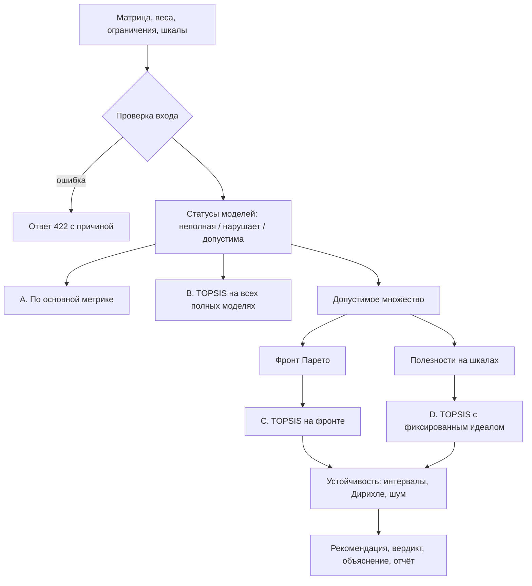

<i>Рисунок 2 — Алгоритм Decision Lab</i>

### 3.7 Логический отпечаток пакета

Отпечаток `dataarena-logical-sha256-v1` вычисляется по логическому содержимому данных
(схема, типы, значения в нормативном порядке строк), а не по байтам Parquet. Поэтому
один и тот же датасет, записанный разными версиями библиотек, имеет одинаковый отпечаток;
это проверяется в CI на двух версиях Polars.

---

## 4 Описание архитектуры

### 4.1 Архитектурный стиль

Программа построена как **клиент-серверное приложение с многослойным сервером**
(layered architecture с выделенными адаптерами, близкая к «портам и адаптерам»).
Оба процесса — сервер и интерфейс — работают на одном компьютере.

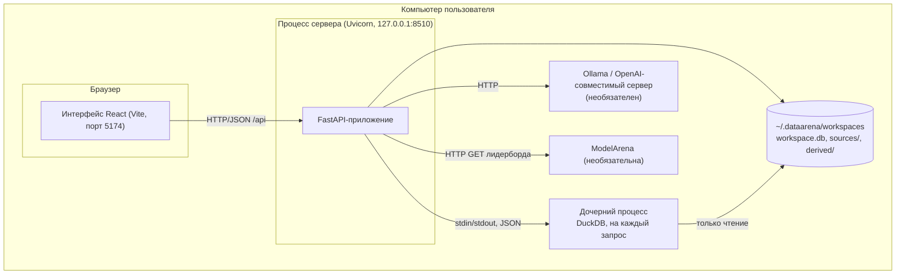

<i>Рисунок 3 — Схема развёртывания</i>

### 4.2 Слои сервера

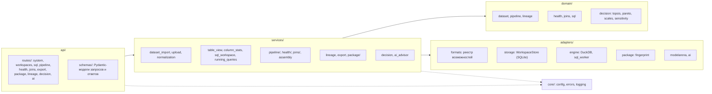

<i>Рисунок 4 — Слои и модули сервера</i>

<b>Таблица 3 — Ответственность слоёв</b>

| Слой | Может зависеть от | Ответственность |
|---|---|---|
| `api` | `services`, `core` | маршруты, проверка входа, преобразование доменных ошибок в единый ответ `{"error": {code, message, details}}` |
| `services` | `domain`, `adapters`, `core` | сценарии и транзакции: «загрузить датасет», «выполнить SQL и записать в историю», «собрать пакет» |
| `domain` | только стандартная библиотека и Polars | предметные модели и чистые вычисления; не знает про HTTP, файлы и БД |
| `adapters` | `core` | всё внешнее: форматы файлов, SQLite, DuckDB, HTTP-клиенты |
| `core` | — | настройки из окружения, иерархия ошибок, журнал |

Правило зависимостей проверяется автоматически тестом
[`tests/unit/test_import_graph.py`](../tests/unit/test_import_graph.py): одно нарушение
делает набор красным. Благодаря этому математика Decision Lab и правила диагностики
тестируются без запуска сервера.

### 4.3 Архитектура интерфейса

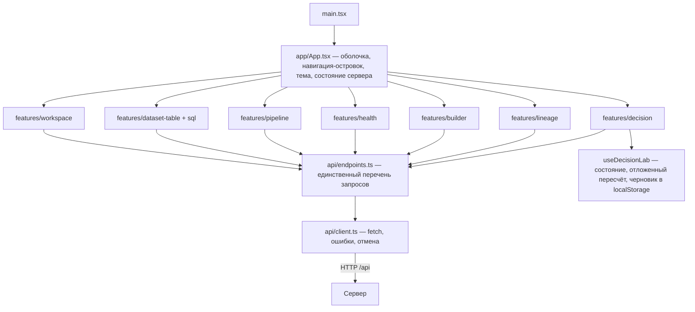

<i>Рисунок 5 — Структура интерфейса</i>

Компоненты не знают путей API: все запросы описаны один раз в `api/endpoints.ts`.
Источник истины — сервер: после перезагрузки страницы состояние (датасеты, шаги,
история отмены, история SQL) приходит с сервера, а не восстанавливается из браузера.
Таблица использует собственную виртуализацию строк. Стили построены на CSS-переменных
(`styles/tokens.css`) с тёмной и светлой темами; UI-фреймворк не используется.

### 4.4 Взаимодействие компонентов

**Выполнение SQL-запроса** с изоляцией движка и отменой:

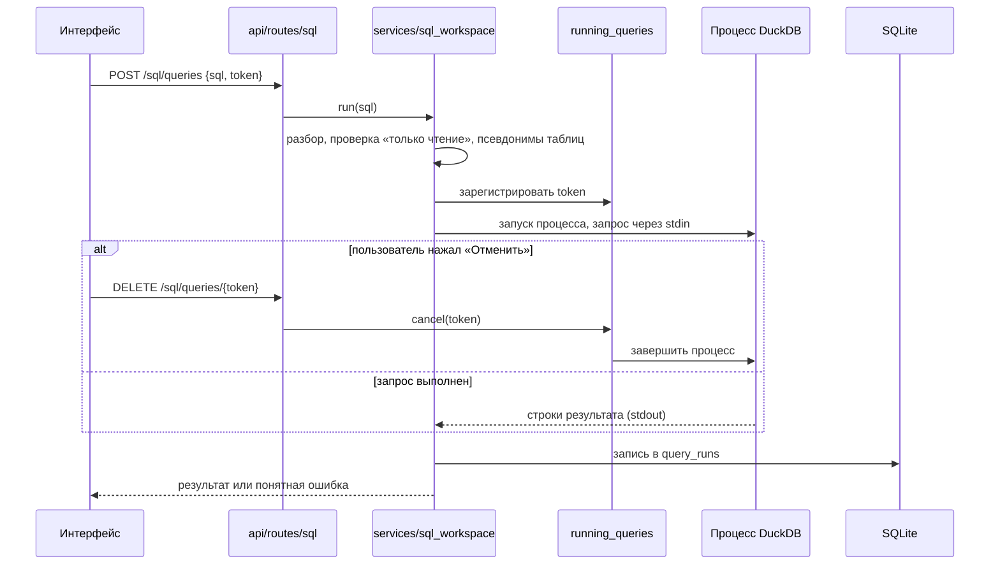

<i>Рисунок 6 — Последовательность выполнения SQL-запроса</i>

**Изменение конвейера и показ результата:**

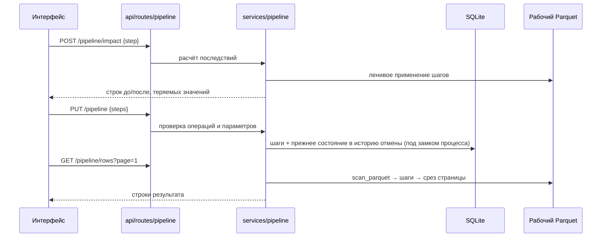

<i>Рисунок 7 — Последовательность работы с конвейером</i>

**Передача в ModelArena и выбор модели:**

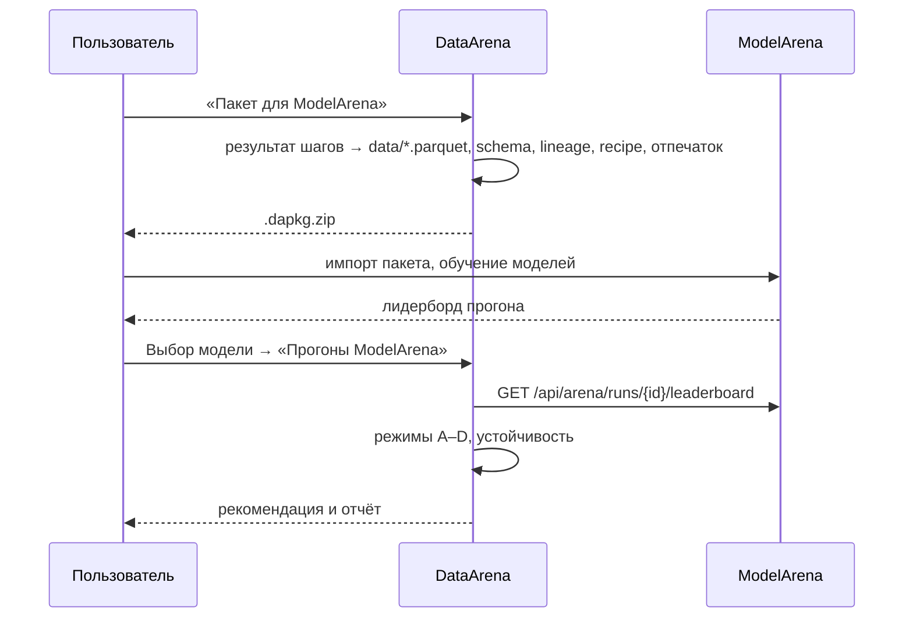

<i>Рисунок 8 — Взаимодействие с ModelArena</i>

### 4.5 Хранение данных

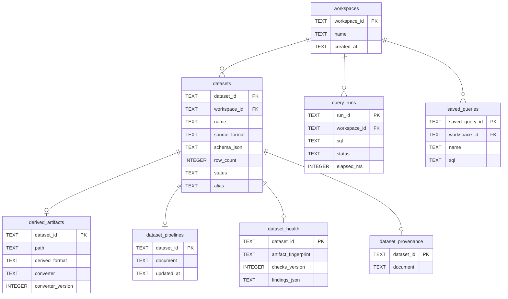

<i>Рисунок 9 — Логическая модель хранилища (показаны ключевые поля)</i>

Метаданные хранятся в SQLite (`workspace.db`) с каскадным удалением; схема версионируется
таблицей `schema_version`. Исходные файлы лежат в `sources/`, рабочие Parquet —
в `derived/`. SQLite выбрана вместо JSON-файлов ради транзакций (импорт регистрирует
датасет и артефакт атомарно) и вместо серверной СУБД — потому что программа локальная
и не должна требовать установки сервера БД.

### 4.6 Обоснование ключевых решений

<b>Таблица 4 — Архитектурные решения</b>

| Решение | Альтернатива | Почему выбрано |
|---|---|---|
| Рабочее пространство на сервере | сервер без состояния, файл в каждом запросе (как в AutoDataAnalysis) | измерено в аудите: повторная загрузка файла на миллион строк при каждой операции делает работу невозможной |
| Ленивое чтение Parquet (Polars `scan_*`) | загрузка таблицы в память целиком | память не растёт с числом открытых страниц; CSV и XLSX нормализуются в Parquet один раз |
| Конвейер как список шагов | изменение данных на месте | исходник неизменен, шаги воспроизводимы, отмена тривиальна, происхождение выводится из шагов |
| DuckDB в отдельном процессе | DuckDB в процессе сервера | нативный сбой движка не роняет сервер; отмена — завершение процесса (долг D-01 закрыт) |
| Перечень разрешённых SQL-функций | перечень запрещённых | новые функции движка по умолчанию недоступны; попытки обхода из аудита воспроизведены тестами |
| Реестр возможностей форматов | условия, разбросанные по коду | предупреждения выгрузки строятся из таблицы; каждый формат подтверждён тестом «запись — чтение» |
| Собственный CSS, три зависимости интерфейса | UI-фреймворк | полный контроль над плотностью; размер сборки |
| Связь с ModelArena через файл-пакет | общий код или общая БД | сервисы развиваются независимо; контракт заморожен и проверяется эталонным валидатором |

Подробное обоснование каждого решения и каждой зависимости —
в [ARCHITECTURE.md](ARCHITECTURE.md), состояние архитектурного долга —
в [ARCHITECTURAL_DEBT.md](ARCHITECTURAL_DEBT.md).

---

## 5 Организация входных и выходных данных

<b>Таблица 5 — Входные данные</b>

| Вход | Формат | Раздел |
|---|---|---|
| Табличные данные | CSV, TSV, Parquet, JSON, JSONL/NDJSON, XLSX, Feather, Arrow IPC; до 512 МБ, JSON — до 100 уровней вложенности | Файлы |
| SQL-запрос | текст, диалект DuckDB, только чтение | Данные |
| Шаги конвейера | операция и параметры (JSON в API) | Конвейер |
| Пара ключей соединения | имена колонок, вид соединения, суффикс | Сборка |
| Характеристики моделей | лидерборд ModelArena, JSON-матрица `{criteria, alternatives}`, CSV с суффиксами `:max`/`:min` и столбцами `X_std` | Выбор модели |
| Параметры выбора | веса, направления, ограничения, шкалы, `seed`, число сценариев | Выбор модели |

Пустая ячейка в характеристиках моделей означает «не измерено» и не заменяется нулём:
такая модель получает статус «нет измерений» и в сравнение не входит.

<b>Таблица 6 — Выходные данные</b>

| Выход | Формат |
|---|---|
| Выгрузка датасета | восемь форматов, перечисленных выше |
| Пакет для ModelArena | `.dapkg` — `manifest.json`, `data/part-*.parquet`, `schema.json`, `profile.json`, `lineage.json`, `recipe.json` |
| Результат SQL | таблица в интерфейсе, запись в истории |
| Отчёт Decision Lab | JSON (полный вход и все режимы — для повторного расчёта), CSV (таблица моделей), Markdown (текстовый отчёт) |

Полное описание входных и выходных данных и HTTP API — в
[Описании программы](PROGRAM_DESCRIPTION.md), разделы 6, 7 и приложение Б.

---

## 6 Выбор технических средств

### 6.1 Программные средства

<b>Таблица 7 — Выбранные программные средства</b>

| Средство | Назначение | Обоснование выбора |
|---|---|---|
| Python 3.12 | язык сервера | экосистема анализа данных; совместимость с ModelArena |
| FastAPI, Pydantic 2 | HTTP-сервер, проверка входа | схемы запросов служат одновременно проверкой и документацией OpenAPI |
| Polars | вычисления над таблицами | ленивые планы и потоковое чтение Parquet; на замерах аудита быстрее и экономнее `pandas` |
| DuckDB | пользовательский SQL | встраиваемый, читает Parquet напрямую, не требует сервера |
| PyArrow, fastexcel, XlsxWriter | форматы Arrow/Feather и Excel | чтение и запись без промежуточных преобразований |
| SQLite | метаданные рабочих пространств | транзакции без сервера БД, входит в стандартную библиотеку |
| React 19, TypeScript, Vite | интерфейс | типизация ответов сервера, быстрая сборка; опыт предшественника |
| pytest, ruff, mypy, Vitest, ESLint | проверка качества | статическая типизация и тесты на обеих сторонах |

### 6.2 Технические средства

<b>Таблица 8 — Требования к компьютеру</b>

| Ресурс | Минимум | Рекомендуется |
|---|---|---|
| Процессор | 2 ядра x86-64 / ARM64 | 4 ядра и более |
| Оперативная память | 4 ГБ | 8 ГБ и более (датасеты на миллионы строк) |
| Диск | 1 ГБ под программу и зависимости | плюс удвоенный объём рабочих данных |
| Экран | 1280 × 720 | 1440 × 900 и выше |
| ОС | Windows 10/11, Linux, macOS | — |
| Сеть | не требуется (кроме установки зависимостей) | — |

---

## 7 Ожидаемые технико-экономические показатели

<b>Таблица 9 — Измеренные показатели</b>

| Показатель | Значение | Источник |
|---|---|---|
| Объём таблицы в разделе «Данные» | до 1 000 000 строк с постраничным чтением | замеры аудита и тесты производительности |
| Расход памяти диагностики | ≈ 0,4 КБ на строку (4 млн строк ≈ 1,5 ГБ) | замер, [README](../README.md#11-ограничения) |
| Накладные расходы изоляции SQL | ≈ 1 с на запрос (запуск процесса) | [ARCHITECTURAL_DEBT.md](ARCHITECTURAL_DEBT.md) |
| Расчёт Decision Lab: 100 моделей, 3 критерия, 2000 сценариев | ≈ 0,3 с | [research/RESULTS.md](research/RESULTS.md) |
| Тесты сервера | 1227 пройдено, 0 упало (на 10.11.2026) | `pytest` |
| Тесты интерфейса | 107 пройдено, 0 упало (на 10.11.2026) | `npm test` |
| Объём кода | ≈ 16,7 тыс. строк Python, ≈ 8,7 тыс. строк TypeScript/CSS | [Описание программы](PROGRAM_DESCRIPTION.md), п. 1.3 |

**Ожидаемый эффект от применения:**

- сокращение времени подготовки датасета за счёт автоматической диагностики
  с переходом к строкам и исправлением в один шаг;
- воспроизводимость: последовательность шагов и происхождение передаются вместе
  с данными в пакете, повторная обработка не требует ручной работы;
- снижение числа ошибок соединения за счёт прогноза размера до выполнения;
- обоснованный выбор модели: рекомендация сопровождается мерой устойчивости
  и объяснением, а не одной метрикой.

**Преимущества перед аналогами.** В отличие от интерактивных блокнотов, DataArena
не изменяет исходные данные и сохраняет каждое действие как отменяемый шаг; в отличие
от облачных платформ подготовки данных, работает локально без передачи данных;
в отличие от выбора по таблице лидеров, учитывает ограничения оборудования
и неопределённость измерений.

---

## 8 Источники, использованные при разработке

1. ГОСТ 19.101-77. ЕСПД. Виды программ и программных документов.
2. ГОСТ 19.402-78. ЕСПД. Описание программы.
3. ГОСТ 19.404-79. ЕСПД. Пояснительная записка. Требования к содержанию и оформлению.
4. ГОСТ 7.32-2017. Отчёт о научно-исследовательской работе. Структура и правила оформления.
5. Hwang C.-L., Yoon K. Multiple Attribute Decision Making: Methods and Applications. —
   Berlin: Springer-Verlag, 1981. — (Lecture Notes in Economics and Mathematical Systems; 186).
6. Behzadian M., Otaghsara S. K., Yazdani M., Ignatius J. A state-of the-art survey of TOPSIS
   applications // Expert Systems with Applications. — 2012. — Vol. 39, № 17. — P. 13051–13069.
7. Документация Polars. — URL: https://docs.pola.rs/
8. Документация DuckDB. — URL: https://duckdb.org/docs/
9. Документация FastAPI. — URL: https://fastapi.tiangolo.com/
10. Документация React. — URL: https://react.dev/
11. Apache Parquet Format Specification. — URL: https://parquet.apache.org/docs/
12. Аудит предшественника AutoDataAnalysis — [AUDIT.md](../AUDIT.md).
13. Спецификация Dataset Package v1 — [contracts/dataset-package-v1.md](contracts/dataset-package-v1.md).
14. Математическая модель Decision Lab — [research/MATHEMATICAL_MODEL.md](research/MATHEMATICAL_MODEL.md).

---

## Приложение А. Экранные формы

Снимки сделаны скриптом `scripts/capture_docs.py` в запущенном приложении (Chrome,
1560 × 1000). Полный набор с подписями — в [README](../README.md#3-интерфейс-программы)
и в [Описании программы](PROGRAM_DESCRIPTION.md#приложение-а-экранные-формы).

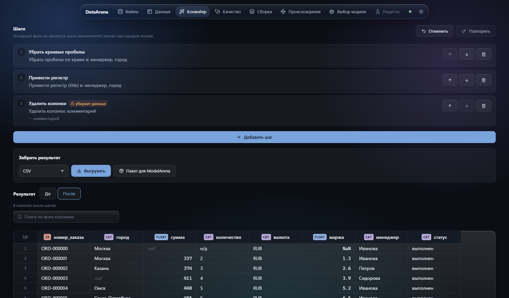

<i>Рисунок А.1 — Раздел «Конвейер»: шаги очистки и результат</i>

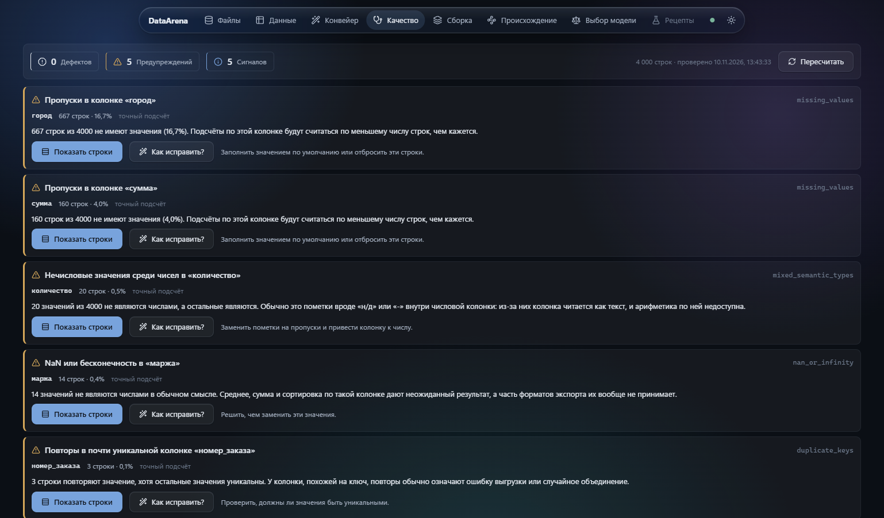

<i>Рисунок А.2 — Раздел «Качество»: находки по результату шагов</i>

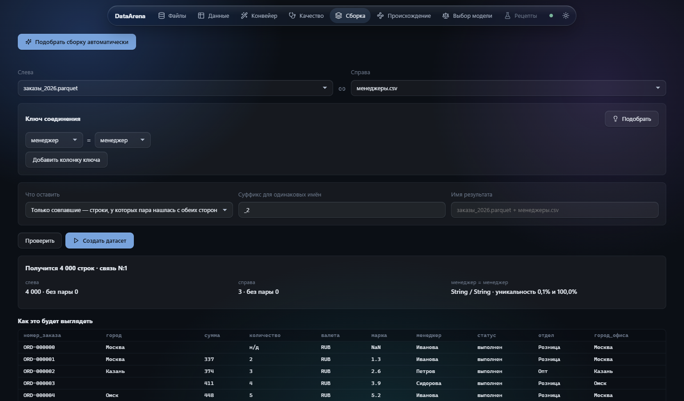

<i>Рисунок А.3 — Раздел «Сборка»: прогноз числа строк и связи до выполнения</i>

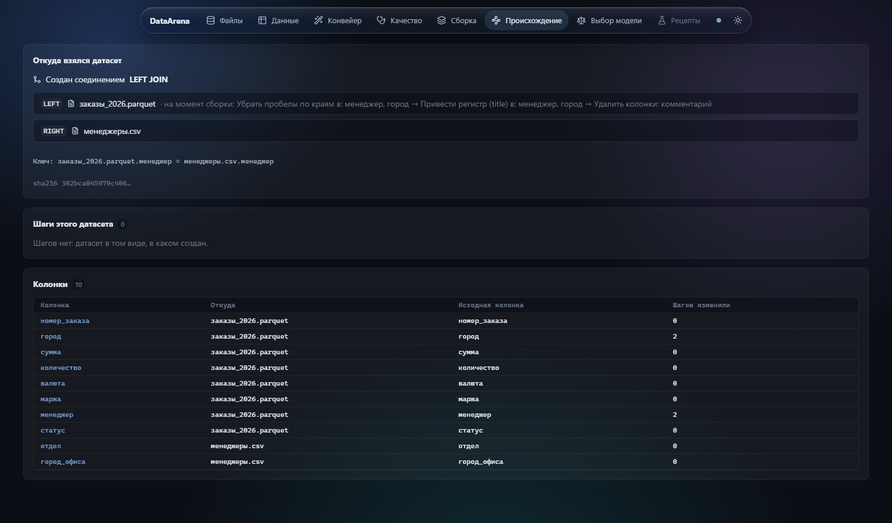

<i>Рисунок А.4 — Раздел «Происхождение» собранного датасета</i>

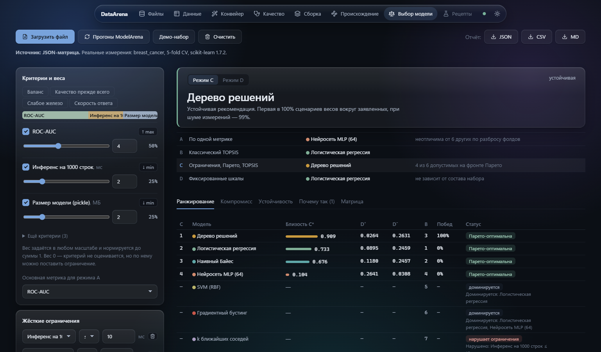

<i>Рисунок А.5 — Decision Lab, режим C: рекомендация и сравнение режимов</i>

