# DataArena. Описание программы

**Документ составлен по структуре ГОСТ 19.402-78 «ЕСПД. Описание программы».**
Состав разделов соответствует стандарту; оформление для печатной версии
(поля, нумерация листов, лист утверждения по ГОСТ 19.104-78 и 19.106-78) выполняется
при переносе в текстовый редактор.

| Реквизит | Значение |
|---|---|
| Наименование программы | DataArena — локальная рабочая среда подготовки табличных данных и многокритериального выбора моделей машинного обучения |
| Обозначение | DataArena 0.1.0 |
| Разработчик | проект FORIT TECH |
| Связанная программа | ModelArena (обучение и сравнение ML-моделей), репозиторий `forit-tech/ModelArena` |
| Дата редакции | 10.11.2026 |

## Аннотация

Документ описывает назначение, логическую структуру, технические средства, порядок
запуска, входные и выходные данные программы DataArena. Программа позволяет загрузить
табличные данные в разных форматах, исследовать и очистить их воспроизводимыми шагами,
собрать датасет из нескольких источников, выгрузить его и передать в ModelArena через
пакет Dataset Package v1, а также выбрать ML-модель по нескольким противоречивым
критериям (качество, время, размер) с помощью методов многокритериального принятия решений.
Математическая часть раздела Decision Lab описана в `docs/research/`.

## Содержание

1. [Общие сведения](#1-общие-сведения)
2. [Функциональное назначение](#2-функциональное-назначение)
3. [Описание логической структуры](#3-описание-логической-структуры)
4. [Используемые технические средства](#4-используемые-технические-средства)
5. [Вызов и загрузка](#5-вызов-и-загрузка)
6. [Входные данные](#6-входные-данные)
7. [Выходные данные](#7-выходные-данные)
8. [Приложение А. Экранные формы](#приложение-а-экранные-формы)
9. [Приложение Б. Программный интерфейс (HTTP API)](#приложение-б-программный-интерфейс-http-api)
10. [Приложение В. Проверка качества программы](#приложение-в-проверка-качества-программы)

---

## 1. Общие сведения

### 1.1. Обозначение и наименование

DataArena, версия 0.1.0. Формат пакета для ModelArena: `dataarena.package/1`, версия 1.1.0,
алгоритм отпечатка данных `dataarena-logical-sha256-v1`.

### 1.2. Программное обеспечение, необходимое для функционирования

| Компонент | Версия | Назначение |
|---|---|---|
| Python | 3.12 – 3.13 (проверено 3.12.10) | серверная часть |
| Node.js | 22+ (проверено 24.14.0) | сборка и запуск интерфейса |
| Веб-браузер | Chrome, Edge, Firefox последних версий | интерфейс пользователя |
| ОС | Windows 10/11, Linux, macOS | — |

Серверные библиотеки (фактически установленные версии): FastAPI 0.141.1, Starlette 1.6.0,
Uvicorn 0.39.0, Pydantic 2.13.5, Polars 1.44.1, DuckDB 1.5.5, PyArrow 25.0.1,
fastexcel 0.21.0, XlsxWriter 3.2.9, NumPy 2.5.3; на Windows — tzdata (база часовых поясов).
Интерфейс: React 19.2.8, TypeScript 5.9.3, Vite 7.3.6, lucide-react 0.468.0.

### 1.3. Языки программирования

* серверная часть — Python (≈ 16,7 тыс. строк в `backend/`);
* интерфейс — TypeScript / TSX и CSS (≈ 8,7 тыс. строк в `frontend/src/`);
* запросы к данным — SQL (диалект DuckDB, только чтение).

---

## 2. Функциональное назначение

### 2.1. Классы решаемых задач

| Раздел интерфейса | Задача |
|---|---|
| Файлы | загрузка нескольких файлов разных форматов в рабочее пространство, нормализация в рабочий Parquet |
| Данные | просмотр таблицы до миллиона строк: постраничное чтение, сортировка, фильтры, поиск, показатели колонки |
| Данные → SQL-запрос | раскрывающаяся панель под таблицей: запросы к нескольким датасетам, история, сохранённые запросы, отмена |
| Конвейер | шестнадцать операций очистки и преобразования, отмена и повтор, предпросмотр последствий шага |
| Качество | диагностика качества (пропуски, дубликаты, типы, выбросы и др.) с переходом к конкретным строкам |
| Сборка | соединение датасетов с анализом ключей и прогнозом числа строк до выполнения |
| Происхождение | откуда взялся датасет и что стало с каждой колонкой |
| Выбор модели (Decision Lab) | многокритериальный выбор ML-модели: TOPSIS, жёсткие ограничения, фронт Парето, фиксированные шкалы, анализ устойчивости, отчёт |

### 2.2. Функциональные ограничения

* программа **локальная**: нет аутентификации и многопользовательского режима;
* DataArena **не обучает модели** — это задача ModelArena; Decision Lab работает с уже
  измеренными характеристиками моделей;
* SQL выполняется только на чтение, в отдельном процессе, с перечнем разрешённых операций;
* раздел Recipes (отдельная работа с рецептами) не реализован, рецепт хранится внутри пакета;
* ModelArena не измеряет время инференса и память — эти величины в Decision Lab
  вводятся из CSV/JSON или измеряются стендом `scripts/research/measure_models.py`;
* результаты Decision Lab — мера компромисса и устойчивости выбора, а не статистическое
  доказательство превосходства модели.

---

## 3. Описание логической структуры

### 3.1. Общая архитектура

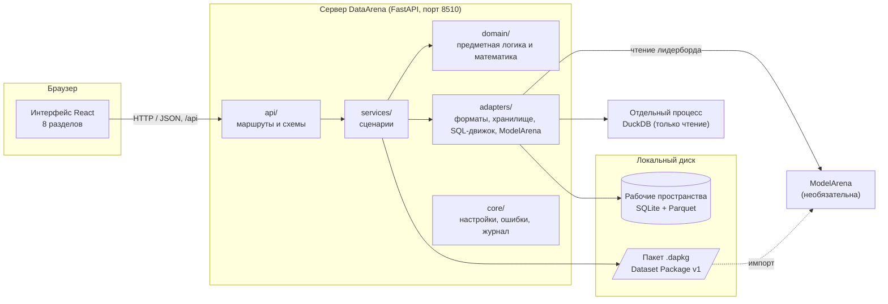

**Правило зависимостей** `api → services → domain`, `services → adapters` проверяется
автоматическим тестом `tests/unit/test_import_graph.py`: слой `domain` не импортирует
HTTP-фреймворк, хранилище и SQL-движок. Благодаря этому математика Decision Lab
тестируется без запуска сервера.

### 3.2. Состав серверной части

| Слой | Каталог | Функции |
|---|---|---|
| HTTP | `backend/api/routes`, `backend/api/schemas` | маршруты, проверка входа (Pydantic), единый формат ошибок `{"error": {code, message, details}}` |
| Сценарии | `backend/services` | загрузка, просмотр, SQL, конвейер, диагностика, соединения, экспорт, пакет, происхождение, Decision Lab |
| Предметная область | `backend/domain` | модели датасета, шаги конвейера, правила диагностики, анализ соединений, происхождение колонок, **многокритериальный выбор** (`domain/decision`) |
| Адаптеры | `backend/adapters` | реестр форматов чтения/записи, хранилище рабочих пространств (SQLite), SQL-движок DuckDB в отдельном процессе, сборка пакета, клиент ModelArena |
| Ядро | `backend/core` | конфигурация из переменных окружения, иерархия ошибок, журналирование |

### 3.3. Состав интерфейса

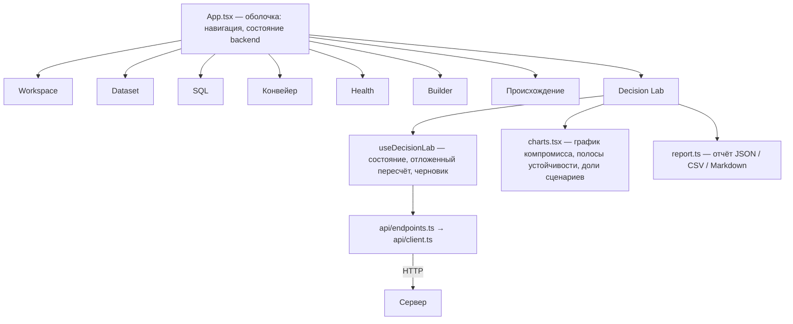

Компоненты не знают путей API: все запросы описаны один раз в `api/endpoints.ts`.
Стили — CSS-переменные (`styles/tokens.css`) и файлы разделов; тёмная тема.

### 3.4. Алгоритм многокритериального выбора (Decision Lab)

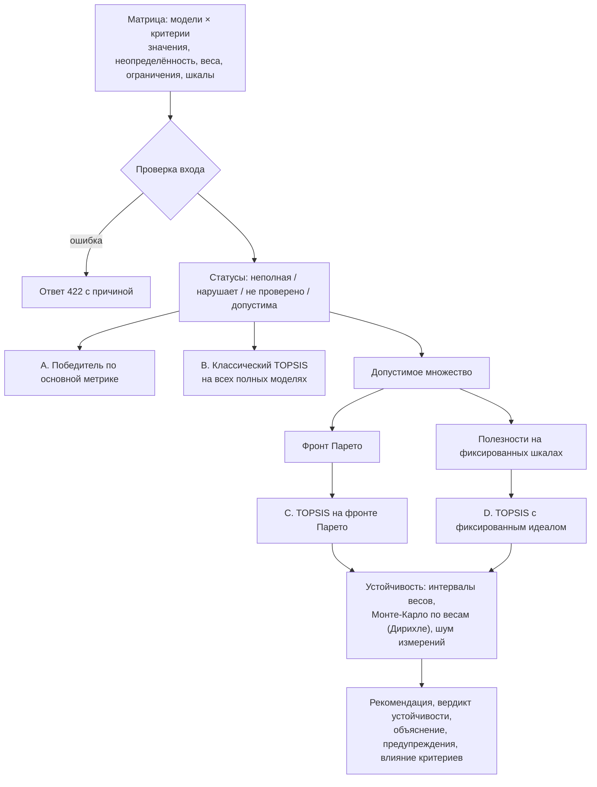

| Режим | Метод | Назначение |
|---|---|---|
| A | максимум (минимум) основной метрики | то, что обычно делают на практике |
| B | TOPSIS (Hwang, Yoon, 1981), векторная нормализация | классический базовый метод |
| C | ограничения → Парето → TOPSIS | устойчив к добавлению доминируемых моделей (доказано) |
| D | ограничения → полезности на шкалах, заданных до сравнения → TOPSIS с фиксированными идеалами | место модели не зависит от состава набора (доказано); исследуемая модификация |

Формулы, доказательства и результаты экспериментов — `docs/research/MATHEMATICAL_MODEL.md`
и `docs/research/RESULTS.md`. Все случайные величины порождаются генератором с заданным
`seed`; отчёт содержит SHA-256 отпечаток входа, повторный расчёт даёт тот же результат.

### 3.5. Связь с другими программами

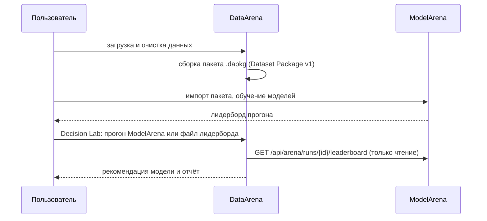

Связь слабая: единственный общий контракт — Dataset Package v1 (заморожен, `docs/contracts/`),
а Decision Lab только читает лидерборд по адресу из настройки `DATAARENA_MODELARENA_URL`.
DataArena полностью работает без ModelArena.

---

## 4. Используемые технические средства

| Ресурс | Минимум | Рекомендуется |
|---|---|---|
| Процессор | 2 ядра x86-64 / ARM64 | 4+ ядра |
| Оперативная память | 4 ГБ | 8+ ГБ (датасеты на миллионы строк) |
| Диск | 1 ГБ под программу и зависимости | + объём рабочих данных × 2 (исходник и рабочий Parquet) |
| Экран | 1280 × 720 | 1440 × 900 и выше |
| Сеть | не нужна (кроме установки зависимостей и необязательной связи с ModelArena на localhost) | — |

Расчёт Decision Lab для 100 моделей, 3 критериев и 2000 сценариев устойчивости занимает
около 0,3 с (измерено, `docs/research/RESULTS.md`).

---

## 5. Вызов и загрузка

### 5.1. Установка

```bash
python -m venv .venv
```

```bash
.venv/Scripts/pip install -e ".[dev]"
```

```bash
cd frontend && npm install
```

(на Linux/macOS — `.venv/bin/pip`).

### 5.2. Запуск

Сервер (порт 8510):

```bash
.venv/Scripts/python -m uvicorn backend.main:app --host 127.0.0.1 --port 8510
```

Интерфейс (порт 5174), из каталога `frontend`:

```bash
npm run dev
```

После запуска открыть в браузере `http://127.0.0.1:5174`. Документация API в формате
OpenAPI — `http://127.0.0.1:8510/docs`.

### 5.3. Настройки (переменные окружения)

| Переменная | По умолчанию | Назначение |
|---|---|---|
| `DATAARENA_WORKSPACE_ROOT` | каталог в профиле пользователя | где хранятся рабочие пространства |
| `DATAARENA_MAX_UPLOAD_MB` | см. `backend/core/config.py` | лимит размера загружаемого файла |
| `DATAARENA_ALLOWED_ORIGINS` | `http://localhost:5174`, `http://127.0.0.1:5174` | разрешённые источники запросов (CORS) |
| `DATAARENA_MODELARENA_URL` | не задан | адрес ModelArena для Decision Lab (например, `http://127.0.0.1:8520`) |

### 5.4. Типовой сценарий работы

1. Файлы → «Загрузить файл» → выбрать CSV/XLSX/Parquet.
2. Данные — просмотреть таблицу и при необходимости выполнить SQL-запрос в панели под ней; Качество — найти проблемы и перейти к строкам.
3. Конвейер — добавить шаги очистки (удалить дубликаты, заполнить пропуски, привести типы).
4. Выгрузить результат (CSV, Parquet, …) или собрать пакет для ModelArena.
5. Обучить модели в ModelArena.
6. Выбор модели → «Прогоны ModelArena» или «Загрузить файл» → задать веса и ограничения →
   получить рекомендацию → переключить режим C/D → выгрузить отчёт.

---

## 6. Входные данные

| Вход | Формат | Где используется |
|---|---|---|
| Табличные данные | CSV, TSV, Parquet, JSON, JSONL/NDJSON, XLSX, Feather, Arrow IPC | Workspace |
| SQL-запрос | текст, только чтение | SQL |
| Шаги конвейера | выбор операции и параметров в интерфейсе (JSON в API) | Конвейер |
| Характеристики моделей | лидерборд ModelArena (JSON), JSON-матрица `{criteria, alternatives}`, CSV (столбцы с суффиксом `:max`/`:min`, столбец `X_std` — неопределённость `X`) | Decision Lab |
| Параметры выбора | веса ≥ 0, направление критериев, ограничения ≤/≥, шкалы режима D, seed и число сценариев | Decision Lab |

Пример CSV для Decision Lab:

```
model,roc_auc,roc_auc_std,inference_ms,model_mb
logreg,0.995,0.006,1.19,0.002
gbm,0.993,0.005,1.42,0.136
```

Пустая ячейка означает «не измерено» и **не заменяется нулём**: модель без измерения
показывается со статусом «нет измерений» и в сравнение не входит.

---

## 7. Выходные данные

| Выход | Формат |
|---|---|
| Выгрузка датасета | CSV, TSV, Parquet, JSON, JSONL, XLSX, Feather, Arrow IPC |
| Пакет для ModelArena | `.dapkg` — Dataset Package v1: данные, схема, рецепт, происхождение, отпечаток |
| Результат SQL | таблица в интерфейсе, история запросов |
| Отчёт Decision Lab, JSON | вход целиком, все режимы, ранжирования, устойчивость, seed, SHA-256 входа — для повторного расчёта |
| Отчёт Decision Lab, CSV | таблица моделей: значения критериев, статус, близости и места по режимам, доли сценариев |
| Отчёт Decision Lab, Markdown | текстовый отчёт для научной работы: критерии, итоги режимов, ранжирование, объяснение, предупреждения |

---

## Приложение А. Экранные формы

Снимки сделаны скриптом `scripts/capture_docs.py` в запущенном приложении (Chrome,
1560 × 1000). Данные Decision Lab — реальные измерения моделей scikit-learn на датасете
breast_cancer (`docs/research/data/breast_cancer.json`).

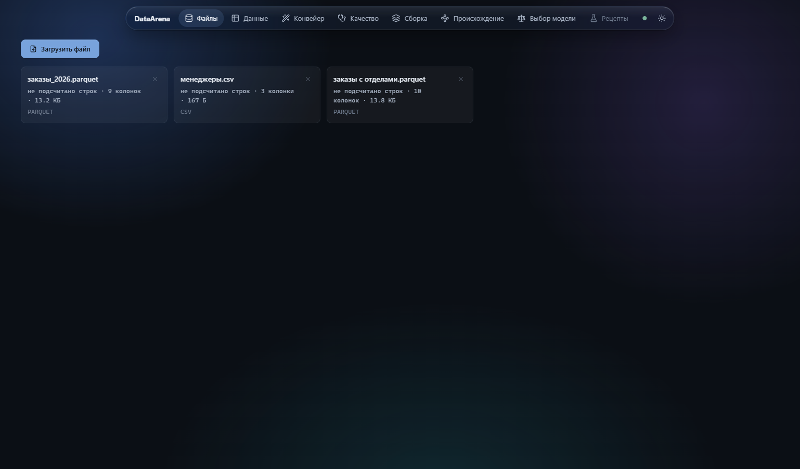

*Рисунок А.1 — Раздел «Файлы»: два источника и собранный из них датасет; навигация — островок вверху экрана*

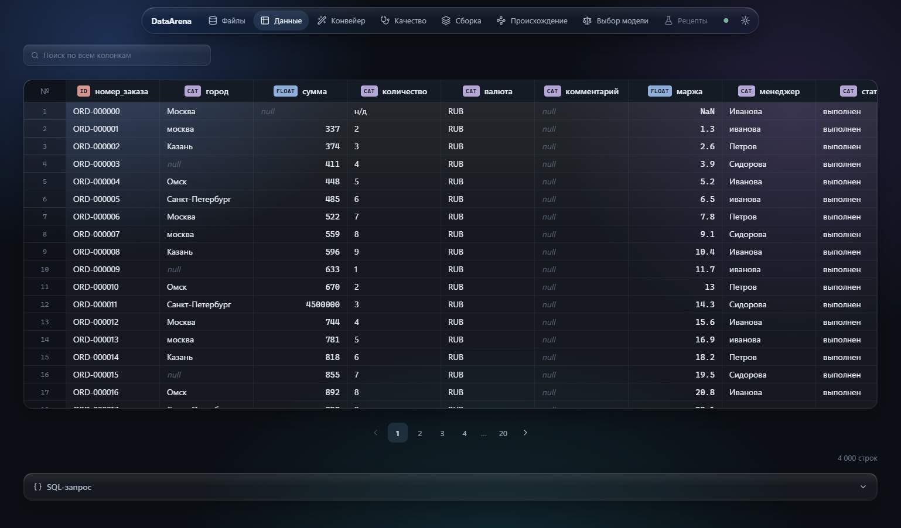

*Рисунок А.2 — Раздел «Данные»: таблица с типами колонок, пропусками, нумерованными страницами и числом строк*

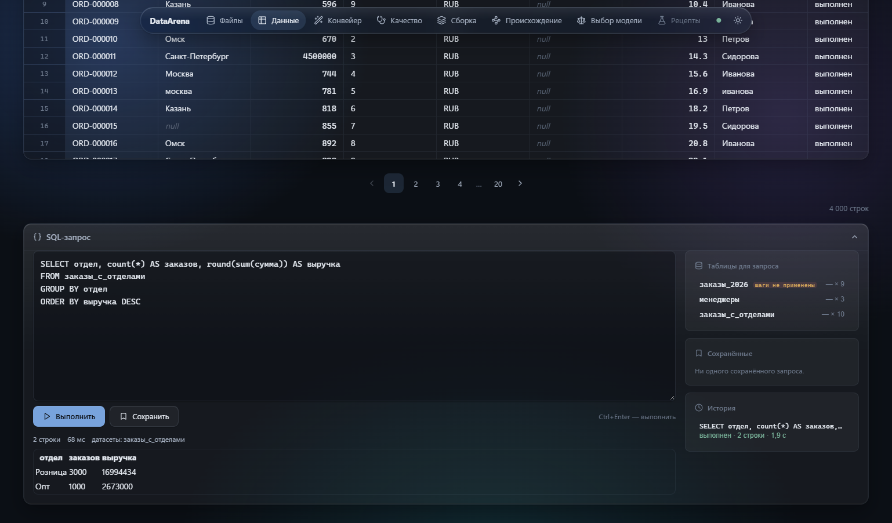

*Рисунок А.3 — Панель «SQL-запрос» под таблицей: запрос к собранному датасету, результат и история*

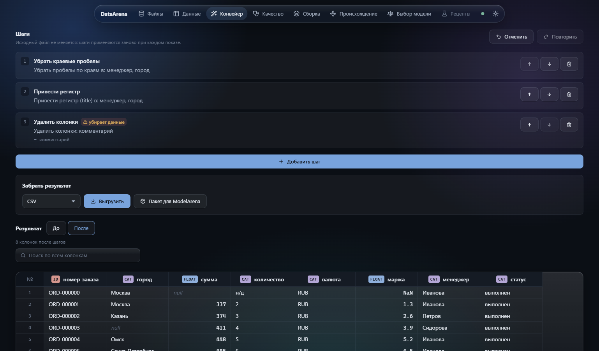

*Рисунок А.4 — Раздел «Конвейер»: три шага очистки, разрушающий шаг помечен «убирает данные»*

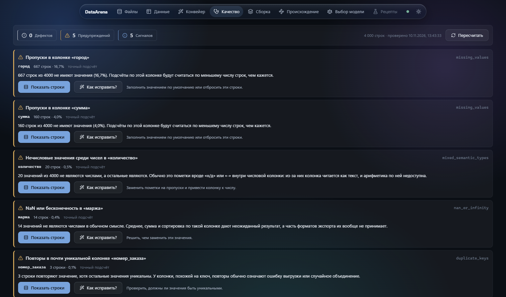

*Рисунок А.5 — Раздел «Качество»: диагностика результата шагов с переходом к строкам*

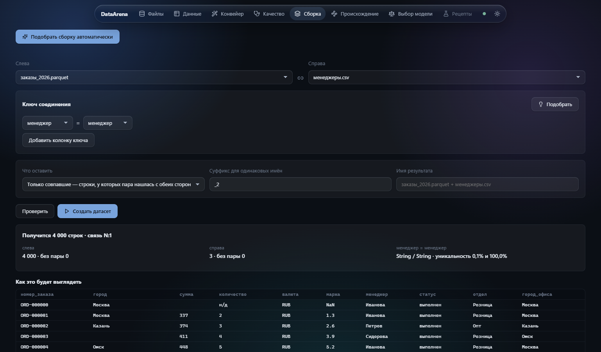

*Рисунок А.6 — Раздел «Сборка»: ключ «менеджер = менеджер», прогноз числа строк и связи N:1 до выполнения*

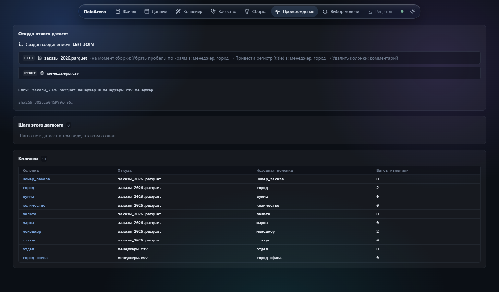

*Рисунок А.7 — Раздел «Происхождение» собранного датасета: родители, их шаги на момент сборки, источник каждой колонки*

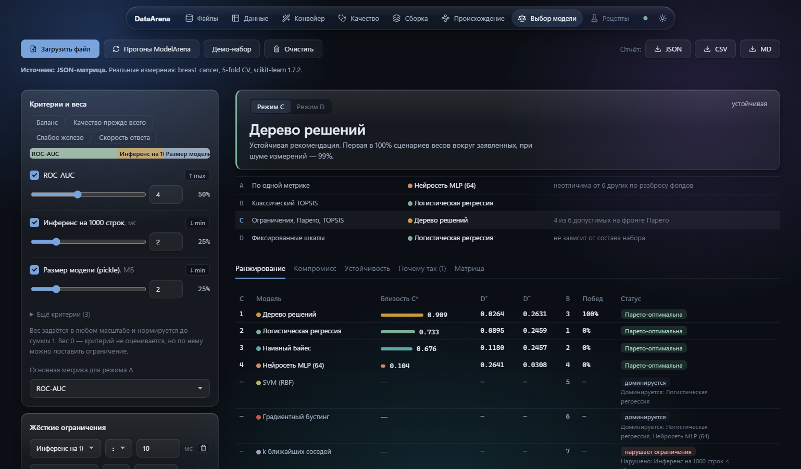

*Рисунок А.8 — Decision Lab, режим C: ограничения «инференс ≤ 10 мс», «размер ≤ 1 МБ»;
рекомендация — дерево решений; таблица под вердиктом сравнивает режимы A–D*

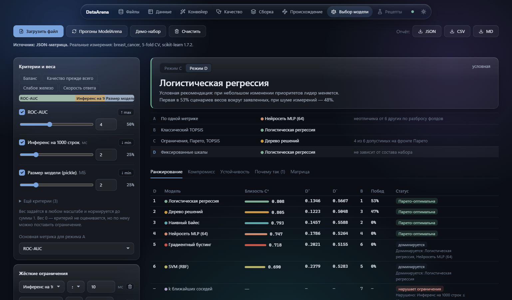

*Рисунок А.9 — Decision Lab, режим D (фиксированные шкалы): при тех же весах и ограничениях
рекомендация — логистическая регрессия (ROC-AUC 0,995 против 0,900)*

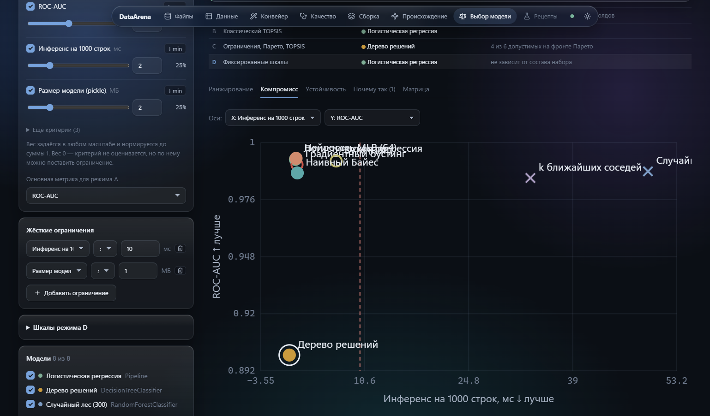

*Рисунок А.10 — Вкладка «Компромисс»: график «качество — инференс»*

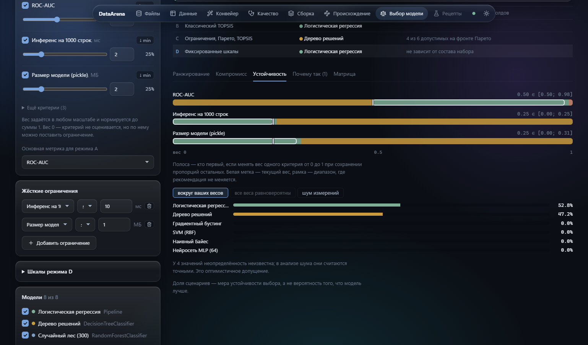

*Рисунок А.10б — Вкладка «Устойчивость»: полосы устойчивости к весам и доли сценариев*

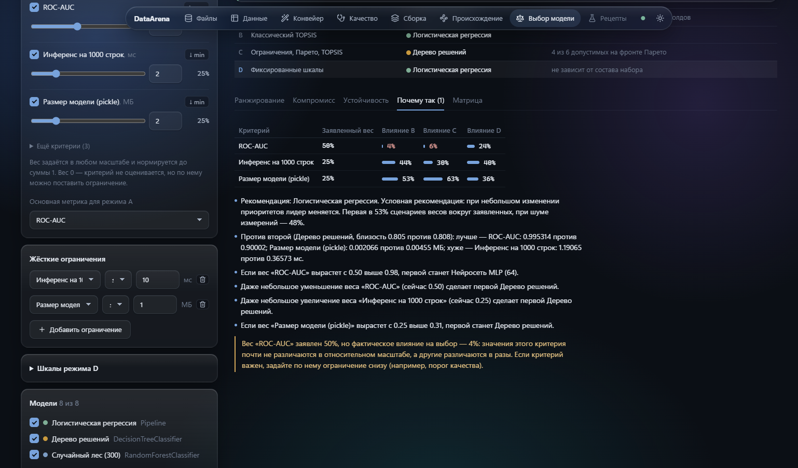

*Рисунок А.11 — Вкладка «Почему так»: заявленный вес и фактическое влияние критериев
в режимах B, C, D, объяснение рекомендации и предупреждения*

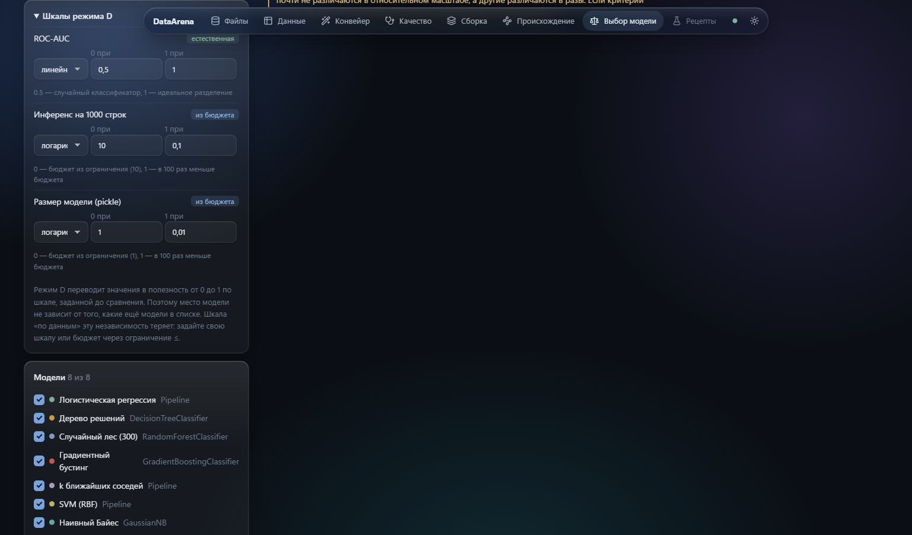

*Рисунок А.12 — Шкалы режима D с указанием источника (естественная, из бюджета)*

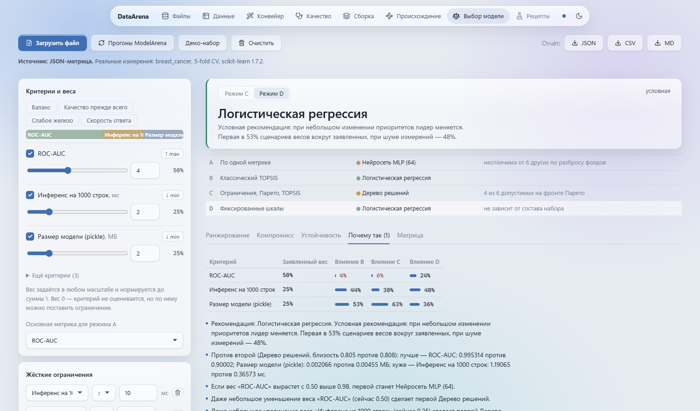

*Рисунок А.13 — Светлая тема: раздел «Выбор модели». Тема переключается кнопкой в островке навигации*

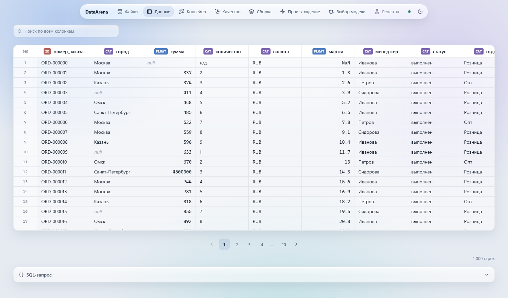

*Рисунок А.14 — Светлая тема: раздел «Данные»*

---

## Приложение Б. Программный интерфейс (HTTP API)

Все пути начинаются с `/api`. Полное описание с примерами — `http://127.0.0.1:8510/docs`.

| Метод | Путь | Назначение |
|---|---|---|
| GET | `/system/health` | состояние сервера и версия контракта |
| POST | `/workspaces` | создать рабочее пространство |
| GET / DELETE | `/workspaces/{workspace_id}` | карточка / удаление рабочего пространства |
| POST / GET | `/workspaces/{workspace_id}/datasets` | загрузить датасет / список датасетов |
| GET | `/workspaces/{workspace_id}/datasets/{dataset_id}` | карточка датасета |
| GET | `/workspaces/{workspace_id}/datasets/{dataset_id}/rows` | страница строк |
| GET | `/workspaces/{workspace_id}/datasets/{dataset_id}/columns/{column}` | показатели колонки |
| GET | `/workspaces/{workspace_id}/sql/datasets` | датасеты, доступные в SQL |
| POST | `/workspaces/{workspace_id}/sql/queries` | выполнить запрос |
| DELETE | `/workspaces/{workspace_id}/sql/queries/{query_token}` | отменить запрос |
| GET | `/workspaces/{workspace_id}/sql/history` | история запросов |
| GET / POST / PUT / DELETE | `/workspaces/{workspace_id}/sql/saved[/{saved_query_id}]` | сохранённые запросы |
| GET | `/pipeline/operations` | словарь операций конвейера |
| GET / PUT | `/workspaces/{workspace_id}/datasets/{dataset_id}/pipeline` | конвейер датасета |
| POST | `…/pipeline/undo`, `…/pipeline/redo` | отмена / повтор |
| POST | `…/pipeline/impact` | предпросмотр последствий шага |
| GET | `…/pipeline/rows` | строки результата конвейера |
| GET | `/workspaces/{workspace_id}/datasets/{dataset_id}/health` | диагностика |
| GET | `…/health/findings/{finding_id}` | строки находки |
| POST | `/workspaces/{workspace_id}/joins/analyse`, `/suggest`, `/preview` | анализ соединения |
| POST | `/workspaces/{workspace_id}/joins` | выполнить соединение |
| GET | `/workspaces/{workspace_id}/datasets/{dataset_id}/lineage` | происхождение |
| GET | `/export/formats` | форматы выгрузки |
| GET | `/workspaces/{workspace_id}/datasets/{dataset_id}/export` | выгрузить датасет |
| GET | `/workspaces/{workspace_id}/datasets/{dataset_id}/package` | пакет для ModelArena |
| POST | `/decision/evaluate` | многокритериальный выбор: режимы A–D и устойчивость |
| POST | `/decision/import` | разобрать файл характеристик моделей |
| GET | `/decision/modelarena/runs` | прогоны запущенной ModelArena |
| GET | `/decision/modelarena/runs/{run_id}` | матрица из лидерборда прогона |

---

## Приложение В. Проверка качества программы

| Проверка | Команда | Результат на 10.11.2026 |
|---|---|---|
| Тесты сервера | `.venv/Scripts/python -m pytest` | 1227 пройдено, 0 упало (112 с) |
| Статический анализ | `.venv/Scripts/ruff check backend tests` | без замечаний |
| Проверка типов | `.venv/Scripts/python -m mypy` | без ошибок |
| Тесты интерфейса | `npm test` (в `frontend`) | 107 пройдено, 0 упало |
| Линтер интерфейса | `npm run lint` | без замечаний |
| Сборка интерфейса | `npm run build` | успешно |

Математическое ядро проверено на вручную рассчитанном примере TOPSIS
(`MATHEMATICAL_MODEL.md`, разд. 2.6), на краевых случаях (одинаковые и нулевые столбцы,
отсутствующие значения, некорректные веса), на доказанных свойствах режимов C и D
(инвариантность к посторонним альтернативам) и на детерминированность при фиксированном
seed — `tests/unit/test_decision.py`, `tests/integration/test_decision_api.py`.
